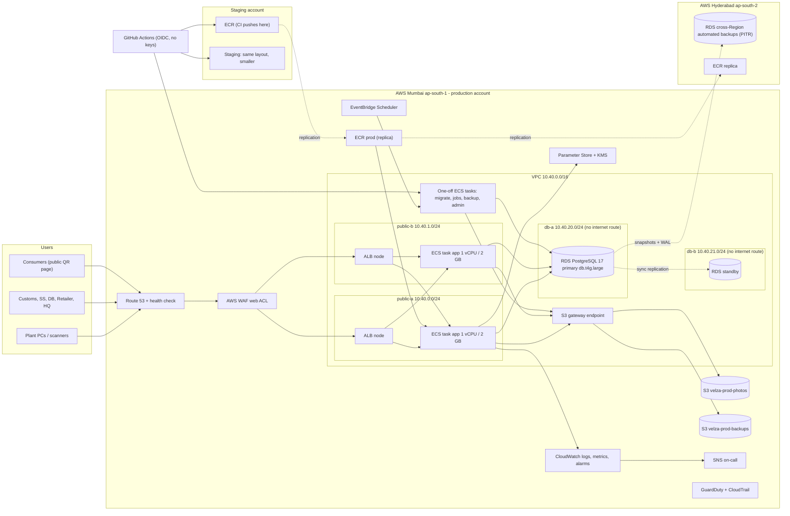
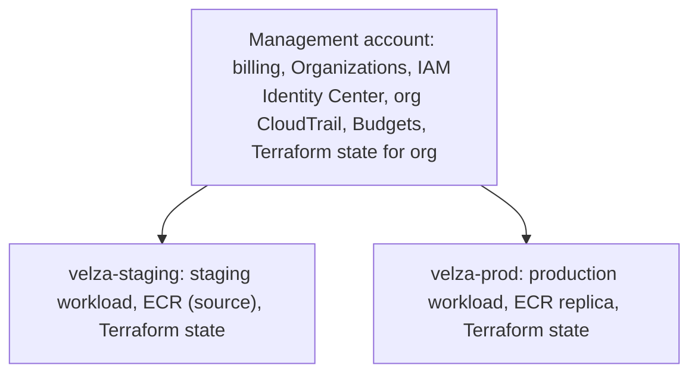

# Go-live architecture on AWS (production + staging)

Status: **design for review (Phase 1)**. Nothing in this document has been created on AWS.
Owner: backend/infra · Date: 25 Nov 2026 · Companion docs: [`RELEASE_PIPELINE.md`](RELEASE_PIPELINE.md),
[`GO_LIVE_APP_CHANGES_AND_PLAN.md`](GO_LIVE_APP_CHANGES_AND_PLAN.md).

Sources read: this repo (`README.md`, `CLAUDE.md`, `AGENTS.md`, `SECURITY.md`, `docs/DEPLOYMENT.md`,
`docs/SCALABILITY_REPORT.md`, `Dockerfile`, `deploy/`, `infra/terraform/`, `.github/workflows/`, `src/lib/store/`,
`src/lib/security.ts`, `src/lib/services/auth.ts`, `src/lib/services/damagePhotos.ts`) and the four documents in
`Velza_Tracebility/25` (go-live PDF and deck, *AWS Database Design v11*, `DB_REQUIREMENTS_FOR_DEVOPS.md`).

The Lightsail setup in `infra/terraform/{global,envs,modules/velza_env}`, `deploy/` and `deploy*.yml` stays as the
**pilot** and keeps working until cut-over. The go-live design lives in new Terraform roots (`infra/aws/…`, section 12)
so the two never share state.

---

## 1. Decisions made in this design

| # | Decision | Why | Cost effect (₹/month, before GST, ₹94/USD) |
|---|---|---|---|
| D1 | **PostgreSQL 17** on RDS (not 16) | RDS standard support for 17 runs to 28 Feb 2030, one year longer than 16 (28 Feb 2029); after that RDS bills Extended Support automatically. CI's schema-upgrade job and the scalability report already run on PostgreSQL 17. 17 also reduces vacuum memory use on big, frequently updated tables like `codes`. The v11 design uses no 16-only features or extensions. **Condition:** re-run the v11 checks (34 SQL checks + Supabase rehearsal) on 17 in CI before Phase 4. PostgreSQL 18 is also on RDS (18.x since Nov 2025), but nothing in this repo has been tested on it; reconsider at the first major upgrade. | 0 |
| D2 | **Public subnets + public IPs for app tasks, no NAT, no interface endpoints** (as costed). The database is in isolated subnets with no internet route. A **free S3 gateway endpoint** keeps photo and backup traffic off the internet. | Within budget. App tasks accept traffic only from the ALB's security group, so a public IP adds no inbound exposure. What remains is egress, which is limited to 443 and 5432 to the database SG. Private subnets would need ECR API/DKR, Logs and SSM interface endpoints in 2 AZs: about **₹6,000–7,100** a month (8 endpoint-AZs × $0.011–0.013/h, rate to confirm). A NAT gateway per AZ would be about **₹7,800**. Subnets for the private option are reserved (section 3), so switching later is a Terraform change, not a redesign. | 0 (private option +₹6,000–7,100) |
| D3 | **RDS cross-Region automated backups** to Hyderabad, instead of an AWS Backup daily snapshot copy | Transaction logs are copied too, so a region loss costs minutes of data instead of up to 24 h. Mumbai → Hyderabad is supported, including for Multi-AZ DB instances. Priced from the AWS Price List on 26 Nov 2026 at the corrected volume: ≈ ₹1,640/month in year 1 (section 11), against the PDF's DR line of ₹4,747. It grows with database size and WAL volume. | ≈ −₹3,100 vs the PDF in year 1 (estimate) |
| D4 | **Customer-managed KMS keys** for production (one in Mumbai, one in Hyderabad); AWS-managed keys in staging | Encryption keys must be chosen when RDS is created. A CMK lets us later copy backups into a separate backup account (ransomware protection), which AWS-managed keys don't allow, and gives a key policy we control. | **+₹188** |
| D5 | RDS master password **managed by RDS in Secrets Manager**; app/owner/read-only passwords generated by a one-off bootstrap task and written to Parameter Store, **never in Terraform state** | The pilot module keeps `random_password` values in state. Acceptable for the pilot, not for go-live. | **+₹75** (2 secrets) |
| D6 | **ECR in the staging account, replicated to production**. Production deploys by **image digest**; CI has no push rights in production. | Build once, promote the exact bytes. A compromised CI run can't put an image straight into production. | **+₹50** (second copy of images) |
| D7 | **No "every minute" rollup job.** The app already rolls up stock after requests (`SqlStore.rollupStock`, guarded by `stock_summary_rollup()`). The nightly recount check is the safety net. | An ECS task every minute is about ₹880 a month and 43,200 cold starts for something the app already does. | 0 (keeping it: +₹880) |
| D8 | WAF Core rule set with **`SizeRestrictions_BODY` set to Count** | On an ALB, WAF inspects only the first 8 KB of a body, and that rule blocks anything larger. Damage reports send about 8 MB of base64 photos, and other JSON bodies can exceed 8 KB (the app allows 256 KB). The app enforces its own limits. | 0 |
| D9 | Multi-AZ **DB instance** (one standby), not a Multi-AZ DB cluster | As costed. The cluster type (two readable standbys, ~35 s failover) needs three instances, and cross-Region automated backups don't support it. It is not listed for t4g/m7g in the Mumbai price list on 26 Nov 2026 (check `aws rds describe-orderable-db-instance-options`). The smallest listed option is `db.m6gd.large` at $0.742/h, about **+₹28,000 a month** over `db.t4g.large` Multi-AZ. | 0 |
| D10 | App tasks **start at 1 vCPU / 2 GB, x86_64, desired 2 (one per AZ), auto scaling 2–4**. **Approved by Kailash 26 Nov 2026.** | Sized for the corrected peak of ≈ 35 req/s (3,43,20,000 packs a year). Memory is 2 GB because the measured app process peaked at 0.65–1.2 GB (`SCALABILITY_REPORT.md`), so 1 GB is not safe. Starting at 1 vCPU keeps a wide CPU margin until Node CPU per request has been measured. Tasks **shrink to 0.5 vCPU / 2 GB only after the load test (Phase 10) shows CPU per request ≤ ~15–20 ms**; that is a task-definition change worth −₹3,120/month (section 11 options). Max 4 is the most the connection budget allows (section 5). ARM64 stays an option (section 11). | 0 (as costed in section 11) |
| D11 | RDS **`db.t4g.large` Multi-AZ, gp3 200 GiB (autoscaling max 500 GiB)** (was `db.m7g.large`, 500 GiB) | **Approved by Kailash 26 Nov 2026** (sizing in `DATABASE_GO_LIVE.md` §2/§2a): the smallest safe class at the corrected volume. Same 8 GiB RAM as `m7g.large`, which is the first step up if CPU credits run out. Worst case on cost: even at 100 % CPU all month, surplus credits ≈ (1.0 − 0.3) × 2 vCPU × 730 h × $0.075 ≈ ₹7,200, so ≈ ₹30,100 for the instance. That is still below `db.m7g.large` Multi-AZ at ₹32,870. | ≈ −₹17,300 vs `db.m7g.large` + 500 GiB (₹45,180 → ₹27,850) |

---

## 2. Architecture



**Accounts** (AWS Organizations):



The pilot's existing AWS account becomes the **management account** (open question Q1), and the pilot stays in it
until cut-over. No new workloads are put in the management account.

### How a request flows

1. Scanner/browser → `app.velzaglobal.com` (Route 53 alias) → ALB on 443 (ACM certificate; port 80 only redirects).
2. WAF rules run on the ALB. The ALB adds the client IP as the **last** `X-Forwarded-For` entry and forwards plain HTTP
   to a healthy task on port 3000 in either AZ.
3. The task checks session, role and partner. It runs one `SERIALIZABLE` transaction on RDS (retried on `40001`/`40P01`)
   and answers.
4. Every write is copied synchronously to the standby before the commit returns.
5. Logs go to CloudWatch Logs as JSON lines (app change C6), with metric filters for security events, failed scans and
   job heartbeats.

---

## 3. Network layout

| VPC | CIDR | Notes |
|---|---|---|
| production (Mumbai) | `10.40.0.0/16` | 2 AZs: `ap-south-1a`, `ap-south-1b` (pinned by AZ ID in Terraform) |
| staging (Mumbai) | `10.41.0.0/16` | same layout, separate account |
| DR (Hyderabad, only built during a region failover) | `10.42.0.0/16` | same module, `region = ap-south-2` |

Subnets per environment (shown for production; staging is the same with `10.41`):

| Subnet | AZ a | AZ b | Route table | Holds |
|---|---|---|---|---|
| public | `10.40.0.0/24` | `10.40.1.0/24` | 0.0.0.0/0 → internet gateway; S3 gateway endpoint | ALB, app tasks, one-off tasks (public IP on) |
| private-app (**reserved, empty**) | `10.40.10.0/24` | `10.40.11.0/24` | local only (+ endpoints if D2 changes) | for the private-subnet option |
| db | `10.40.20.0/24` | `10.40.21.0/24` | local only, **no internet route** | RDS primary and standby (DB subnet group) |

Security groups:

| SG | Inbound | Outbound | Attached to |
|---|---|---|---|
| `alb` | 443 and 80 from `0.0.0.0/0` | 3000 to `app` | ALB |
| `app` | 3000 from `alb` only | 5432 to `db`; 443 to `0.0.0.0/0` (ECR, SSM, Logs, S3) | app tasks |
| `task` | none | 5432 to `db`; 443 to `0.0.0.0/0` | migrate / jobs / backup / admin one-off tasks |
| `db` | 5432 from `app` and `task` | none needed (stateful) | RDS |

There is no SSH, bastion or public database endpoint. Admin access to the database is a one-off `admin` task
(backup image, which has `psql`) opened with **ECS Exec**, and only during a break-glass session (section 6).

---

## 4. Every AWS resource

Production values; staging differences in the last column.

| Area | Resource | Size / setting | Purpose | Staging |
|---|---|---|---|---|
| Org | AWS Organizations, 3 accounts | management, `velza-staging`, `velza-prod` | separation, one bill | — |
| Org | IAM Identity Center | permission sets: `Admin`, `Developer`, `ReadOnly`, `BreakGlass`; MFA required | human sign-in, no IAM users | same |
| Org | Organization CloudTrail | all accounts, mgmt events, S3 log bucket in management account (versioned, 1-year lifecycle) | audit trail | covered |
| Org | GuardDuty | org-wide, delegated admin = management account; RDS protection on | threat detection | covered |
| Org | IAM Access Analyzer (external access) | account analyzer per account | finds resources shared outside | same |
| Org | AWS Budgets | **₹79,000/month including GST** for the whole organisation (section 11 total with GST ≈ ₹74,960, plus ~5 % headroom; was ₹90,000). Alerts (email): **forecasted** spend > 100 %, **actual** spend > 90 % and > 100 %, plus Cost Anomaly Detection (free) for early warning. No 80 % forecast alert: normal spend is ≈ 95 % of the budget, so it would fire every month and be ignored. Budgets are stated including GST because AWS Budgets counts tax by default, so on an AWS India (AISPL) bill they include GST | cost control | **₹13,000 including GST** (staging ≈ ₹12,020 with GST + ~5 %), same alert rules |
| State | S3 bucket `velza-tfstate-<account-id>` per account | versioned, SSE-KMS, public access blocked, `use_lockfile = true` (S3-native locking, Terraform ≥ 1.10) | remote state with locking, no DynamoDB | same |
| Network | VPC, 6 subnets, IGW, route tables, S3 gateway endpoint | section 3 | network | same |
| Entry | Route 53 hosted zone | `app.velzaglobal.com` (delegated subdomain or the whole zone, Q2) + 1 health check on `/api/health` | DNS, uptime check | `staging.velzaglobal.com` |
| Entry | ACM certificate | DNS-validated | TLS | same |
| Entry | Application Load Balancer | 2 AZs, HTTPS listener `ELBSecurityPolicy-TLS13-1-2-2021-06`, 80→443 redirect, idle timeout 60 s, deregistration delay 30 s, health check `GET /api/health` every 15 s (2 healthy / 3 unhealthy), deletion protection on | one HTTPS entry | same, deletion protection off |
| Entry | AWS WAF web ACL on the ALB | `AWSManagedRulesCommonRuleSet` (with `SizeRestrictions_BODY` = Count, D8), `KnownBadInputs`, `AmazonIpReputationList`; rate rules: 10,000 req / 5 min per IP (all paths; the app allows 1,200/min per client because shops share IPs) and 600 / 5 min per IP on `/api/lookup` + `/t/` (public QR). **Pricing changes on 1 Feb 2027**: the per-ACL, per-rule and WCU charges are replaced by $0.01/h per protected resource + $0.60 per million requests, and these three managed groups are included. Same rules, about ₹250/month less per environment (section 11) | block abuse and floods | same rules, Count mode for the first week |
| App | ECR repositories `velza-app`, `velza-ops`, `velza-backup` | in staging, tag immutability, scan on push (basic), lifecycle: keep 50 newest; replication → prod (Mumbai) → prod (Hyderabad) | images | source |
| App | ECS cluster `velza` | Fargate only; Container Insights off (standard metrics are free) | runs containers | same |
| App | ECS service `app` | task **1 vCPU / 2 GB** (D10; 0.5 vCPU / 2 GB only after the load test proves CPU per request ≤ ~15–20 ms), Linux x86_64 (ARM64 is an option, section 11), desired 2 (one per AZ), auto scaling **2–4** with target tracking on CPU 50 % and ALB request count per target 900/min (≈ 15 req/s), scale-out cooldown 60 s, scale-in 300 s. Max 4 is capped by the connection budget (section 5). Proposed `NODE_OPTIONS=--max-old-space-size=1280` so the Node heap stays inside the 2 GB task with room for request buffers (to be confirmed in the load test). Deployment min 100 % / max 200 %, circuit breaker with rollback, `stopTimeout` 30 s, health-check grace 60 s, public IP on, spread across AZs, ECS Exec **off** by default | the web app | desired 1, **0.5 vCPU / 2 GB** (2 GB for the same memory reason as production), no auto scaling |
| App | Task definitions `velza-ops-migrate`, `velza-ops-jobs`, `velza-backup`, `velza-admin` | 0.5 vCPU / 1 GB (admin: ECS Exec on) | migrations, scheduled jobs, pg_dump, break-glass psql | same |
| App | EventBridge Scheduler schedules | 02:00 IST `db:maintenance`; 02:30 IST `db:stock -- check`; **03:00 IST** `velza-backup now` while the DB < 50 GB (was 01:30, moved clear of the RDS maintenance window); flexible window off | scheduled jobs (section 9) | same |
| Data | RDS PostgreSQL **17** (D1), Multi-AZ DB instance | **`db.t4g.large`** (2 vCPU Graviton2 burstable, 8 GiB; Unlimited credit mode) (D11, `DATABASE_GO_LIVE.md` §2a), gp3 **200 GiB** allocated, baseline **3,000 IOPS / 125 MiB/s** included (can't be raised below 400 GiB; at ≥ 400 GiB it becomes 12,000 IOPS / 500 MiB/s automatically), storage autoscaling **max 500 GiB**. Upgrade path: `db.m7g.large` (CPU) or `db.r7g.large` (memory), a class change with ~1–2 min Multi-AZ failover. Encrypted with CMK (D4), backup retention 14 days, backup window 19:00–19:30 UTC (00:30–01:00 IST), maintenance Sun 20:00–20:30 UTC (= **Mon 01:30–02:00 IST**; `velza-backup` runs at 03:00 IST so it never overlaps, see section 9), deletion protection on, final snapshot on, Performance Insights on (7 days, free), auto minor version upgrade **off** (applied by hand in the Mon 01:30–02:00 IST window; `DATABASE_GO_LIVE.md` §2), IAM DB auth off, publicly accessible **no** | the database | `db.t4g.small` Single-AZ, 50 GiB gp3, retention 7 days, deletion protection off |
| Data | RDS parameter group `velza-pg17` | `DATABASE_GO_LIVE.md` §2 / `DB_REQUIREMENTS_FOR_DEVOPS.md` §4 (force_ssl, pg_stat_statements, **`max_connections` 150** (was 200), autovacuum and logging settings; memory settings on the RDS formulas) | tuning | separate group **`velza-pg17-staging`**: same, but `max_connections` 60, `work_mem` 8MB and smaller maintenance/autovacuum memory (`DATABASE_GO_LIVE.md` §2) |
| Data | RDS cross-Region automated backups (D3) | to `ap-south-2`, retention 14 days, CMK in Hyderabad | region DR with PITR | off |
| Data | S3 `velza-prod-photos-<acct>` | SSE-KMS (bucket key), versioning on, public access blocked, `BucketOwnerEnforced`, TLS-only policy, lifecycle: noncurrent versions expire after 90 days; no delete permission for the app | damage photos (evidence) | `velza-staging-photos` |
| Data | S3 `velza-prod-backups-<acct>` | same protections; lifecycle: `db/daily/` expire 14 days, `db/monthly/` → Glacier Instant Retrieval after 30 days, expire 400 days; `archive/` (closed history months) → Glacier Deep Archive after 30 days, never expire | logical dumps, archived history | same, short expiry |
| Data | S3 `velza-prod-logs-<acct>` (optional) | ALB access logs, 30-day expiry | forensics | off |
| Secrets | Parameter Store `/velza/prod/*` | SecureString with the prod CMK (section 7) | settings and DB URLs | `/velza/staging/*` |
| Secrets | Secrets Manager | RDS-managed master password only (D5) | emergency master login | same |
| Secrets | KMS | `alias/velza-prod` (Mumbai), `alias/velza-prod-dr` (Hyderabad), rotation on | encryption | AWS-managed keys |
| Observe | CloudWatch log groups | `/velza/prod/app`, `/velza/prod/jobs`, `/aws/rds/instance/velza-prod/postgresql`; 30-day retention | logs | 14 days |
| Observe | CloudWatch dashboard `velza-prod` | ALB, ECS, RDS, WAF, job heartbeats | one screen | same |
| Observe | CloudWatch alarms | section 10 | detection | fewer, email only |
| Observe | SNS topics `velza-prod-page`, `velza-prod-ticket` | email (+ SMS/phone, Q8) | on-call | `velza-staging-ticket` |
| Support | AWS Business Support+ | production account only | 24/7 help | none |

---

## 5. Capacity and connection maths

| | Steady | Peak (auto scaling) | Peak + deploy surge (max 200 %) |
|---|---|---|---|
| App tasks × `PG_POOL_MAX` 10 | 2 × 10 = 20 | 4 × 10 = 40 | 8 × 10 = 80 |
| Jobs / migration / backup / admin | ≤ 6 | ≤ 6 | ≤ 6 |
| RDS internal (`rdsadmin`) | ~5 | ~5 | ~5 |
| Read-only reports | ≤ 5 | ≤ 5 | ≤ 5 |
| **Total** | **~36** | **~56** | **~96** |

`max_connections` = **150** (parameter group; was 200). `velza_app` gets **`CONNECTION LIMIT 100`** in `roles_v11.sql`
(was 150, which would equal the new maximum). That covers 80 app connections in a rolling deploy, 3 for jobs and some
spare, and still leaves ≥ 45 slots for `velza_owner`, `velza_readonly` and RDS admin even if the app pool runs away.
The worst case of ≈ 96 is 64 % of 150, and the `DatabaseConnections` alarm fires at > 110 (section 10). There are two rules
(`DATABASE_GO_LIVE.md` §6), and both must be rechecked whenever auto scaling max or `PG_POOL_MAX` changes:

- **max tasks × `PG_POOL_MAX` × 2 (rolling deploy) + 25 ≤ 0.7 × `max_connections`** (was 0.6; relaxed to 0.7 so 4 tasks
  fit at `max_connections` 150). Today 4 × 10 × 2 + 25 = 105 ≤ 105.
  **This is why auto scaling stops at 4.** A 5th task would need `PG_POOL_MAX` 8 or a larger instance. Task size
  (1 vCPU or 0.5 vCPU) doesn't change this maths: it depends only on task count and `PG_POOL_MAX`.
- **`velza_app` limit ≥ max tasks × `PG_POOL_MAX` × 2 + 10.** Today 90 ≤ 100.

No RDS Proxy or PgBouncer: code allocation holds a **session** advisory lock (`driver.ts`), so `DATABASE_URL_UNPOOLED`
stays **unset** and one direct pool is used (app change C5).

**Throughput (corrected volume).** 3,43,20,000 packs a year is ≈ 8–11 req/s on average and ≈ 35 req/s at peak (was
150 req/s). The table shows the load per task. "CPU per request" is the Node CPU time per request, which hasn't been
measured on Fargate yet; 10–30 ms is assumed, covering API calls (zod, `pg`, JSON) up to server-rendered pages.

| Tasks running (1 vCPU each, D10) | Req/s per task at 35 req/s | Task CPU at 10 ms / request | Task CPU at 30 ms / request |
|---|---|---|---|
| 2 (normal) | 17.5 | 18 % | 53 % |
| 3 | 11.7 | 12 % | 35 % |
| 4 (max) | 8.75 | 9 % | 26 % |
| 1 (one AZ lost: **1–3 min typical, up to ~5 min** until ECS has the replacement running in the other AZ) | 35 | 35 % | 105 %: requests queue, p95 rises until the 2nd task is up |

At 4 tasks the service can take about 4 vCPU × 70 % ÷ CPU-per-request: ≈ 280 req/s at 10 ms and ≈ 93 req/s at
30 ms. Both are far above the 35 req/s peak. With 0.5 vCPU tasks, 2 tasks at 17.5 req/s and 20 ms per request
would sit at 70 % CPU. That is why shrinking needs a measured CPU per request of ≤ ~15–20 ms. Memory is sized on measurement, not estimate. The app process on
PostgreSQL at 100k rows peaked at 653–691 MB working set after the fixes, and at 1,176 MB before them
(`SCALABILITY_REPORT.md`). Damage reports carry up to several MB of base64 photos per request. A 1 GB task is
therefore **not safe**, and 2 GB is (≈ 3× the current peak).

The scalability report shows single requests at 17–400 ms on PostgreSQL at 100k rows, but the HQ dashboard (1.6 s p95,
11 s at 10 concurrent) and batch list fail the target. The p95 < 500 ms target is **not proven** until the load test
(Phase 10) passes at 35 req/s, with a soak and one task stopped on purpose. If it measures CPU per request at
≤ ~15–20 ms, the task definition can shrink to 0.5 vCPU / 2 GB (−₹3,120/month, no other change).

---

## 6. IAM roles

No IAM users with access keys anywhere. Humans use Identity Center; machines use roles.

| Role | Account | Trusted by | Can do | Can't do |
|---|---|---|---|---|
| `velza-<env>-task-execution` | each | `ecs-tasks.amazonaws.com` | pull from ECR, write to its log groups, `ssm:GetParameters` on `/velza/<env>/*`, `kms:Decrypt` on the env key | anything else |
| `velza-<env>-app-task` | each | `ecs-tasks.amazonaws.com` | `s3:PutObject`, `s3:GetObject` on `photos/damage/*`; `kms:GenerateDataKey/Decrypt` on the bucket key | delete objects, list other buckets, read SSM directly |
| `velza-<env>-ops-task` | each | `ecs-tasks.amazonaws.com` | `s3:PutObject` on `backups/archive/*`; `cloudwatch:PutMetricData` (namespace `Velza/Jobs`) | delete, photos |
| `velza-<env>-backup-task` | each | `ecs-tasks.amazonaws.com` | `s3:PutObject/GetObject/ListBucket` on `backups/db/*`; `s3:DeleteObject` on `backups/db/daily/*` only (pruning) | photos, archive |
| `velza-<env>-admin-task` | each | `ecs-tasks.amazonaws.com` | `ssmmessages:*` (ECS Exec) | S3, SSM parameters |
| `velza-<env>-scheduler` | each | `scheduler.amazonaws.com` | `ecs:RunTask` on `velza-ops-*` / `velza-backup` task definitions; `iam:PassRole` on their two roles | other services |
| `velza-gha-build` | staging | GitHub OIDC, `sub = repo:AbhayVelza/crms_velza_trace:ref:refs/heads/main` | push to the three ECR repos | ECS, SSM, RDS |
| `velza-gha-deploy-staging` | staging | OIDC, `sub = …:environment:staging` | register task definitions; update service `app`; `ecs:RunTask` migrate/admin; `iam:PassRole` on the env task roles; read `/velza/staging/*`; `rds:CreateDBSnapshot`/`Describe*` on the staging DB; read logs | IAM, VPC, anything in prod |
| `velza-gha-deploy-prod` | prod | OIDC, `sub = …:environment:production` | same as staging, on prod resources only | push images, change infrastructure |
| `velza-gha-tf-plan` | each | OIDC, `sub = …:pull_request` | `ReadOnlyAccess` + read state bucket + `kms:Decrypt` for state | any write |
| `velza-gha-tf-apply` | each | OIDC, `sub = …:environment:infra-<env>` (GitHub environment with required reviewers) | `AdministratorAccess` minus Organizations/billing/IAM-Identity-Center (permissions boundary) | org changes, leaving the boundary |
| `BreakGlass` permission set | prod | Identity Center, 2 named people, MFA, 1-hour session | `AdministratorAccess` | — (every sign-in triggers a page via a CloudTrail metric filter) |
| Emergency IAM user `velza-breakglass` | management only | console password + hardware MFA, **no access keys**, credentials sealed | assume `OrganizationAccountAccessRole` | — (every sign-in pages). Used only if Identity Center itself is unavailable |

The existing `global/main.tf` OIDC provider and the `velza-<env>-deploy` roles stay for the pilot.

---

## 7. Secrets and settings

All under `/velza/<env>/` as **SecureString** (CMK in prod), injected by ECS `secrets` (never baked into images or
written to disk). Generated by the one-off `db-bootstrap` task (Phase 4), not by Terraform. Terraform creates each
parameter with a placeholder and `ignore_changes = [value]`.

| Name | Used by | Secret | Rotation |
|---|---|---|---|
| `DATABASE_URL` (`velza_app`, `sslmode=verify-full&sslrootcert=/etc/ssl/aws/rds-global-bundle.pem`) | app, jobs | yes | 90 days (runbook) |
| `MIGRATE_DATABASE_URL` (`velza_owner`) | migrate task only | yes | 90 days |
| `READONLY_DATABASE_URL` (`velza_readonly`) | backup task, reports | yes | 90 days |
| `APP_DB_PASSWORD`, `READONLY_DB_PASSWORD` | `roles_v11.sql` during deploy | yes | with the URLs |
| `VELZA_ADMIN_PASSWORD`, `VELZA_HQ_PASSWORD` | first start only | yes | **delete after go-live** |
| RDS master password | nobody day to day | Secrets Manager (RDS-managed) | RDS rotates (7 days) |
| `PHOTO_BUCKET`, `BACKUP_BUCKET`, `AWS_REGION`, `STORE=postgres`, `SIGN_IN=on`, `PG_POOL_MAX=10`, `CLIENT_IP_HEADER=x-forwarded-for` (C9), `RELEASE_SHA` (set by deploy), `VELZA_SCHEMA_AUTO=off` (C10), `RATE_LIMIT_*` (defaults) | app | no (String) | — |

Build-time values are baked into the image, so they are the same in staging and production (build once):
`HTTPS_ONLY=1` (headers) and `NEXT_PUBLIC_DEMO_HELPER` (must stay **unset**). Staging therefore can't switch on the demo
helper. This is a consequence of build-once, not a bug.

The pilot's Lightsail bucket access keys (`AWS_ACCESS_KEY_ID`/`AWS_SECRET_ACCESS_KEY` in Parameter Store) are
long-lived keys. They are not used in the go-live design: task roles replace them.

---

## 8. Disaster recovery

| Failure | Protection | Data loss (RPO) | Back in (RTO) | Notes |
|---|---|---|---|---|
| App task crash or bad host | ALB health check + ECS replacement | 0 | seconds | in-flight request may fail; scanner retries |
| Bad release | circuit breaker rollback; or one-command rollback to the previous task definition | 0 | 2–10 min | schema stays (expand/contract) |
| One AZ lost | tasks in the other AZ; RDS Multi-AZ failover (synchronous standby) | **0** for committed transactions | **1–2 min** for the database (DNS flip); app pools reconnect; **1–3 min typical, up to ~5 min** until ECS has rescheduled to 2 tasks in the surviving AZ | in-flight transactions fail and are retried by users; Fargate capacity in the surviving AZ during an AZ event is not guaranteed |
| Bad data or human error (wrong bulk update, bad migration) | PITR to a **new** instance at the minute before the mistake; snapshot taken before every migration | up to **~5 min** (RDS uploads transaction logs about every 5 min, so the latest restorable time trails by ≤ 5 min). Data written **after** the chosen point must be re-entered or copied across by hand | **1–3 h** plus checks and the switch (database ≈ 100–110 GB at the end of year 1, ≈ 300 GB by year 3 without archiving; the restore time grows with size) | this is the honest RTO; measure it in the monthly restore drill |
| Owner-level mistake (dropped table) | same as above | same | same | the app role can't drop, truncate or edit history |
| Photo deleted or overwritten | S3 versioning; app has no delete right | 0 | minutes | |
| Mumbai region unavailable | Hyderabad: RDS cross-Region automated backups (PITR), ECR replica; Terraform roots accept `region = ap-south-2` | **minutes** (replication lag of snapshots + logs, typically < 15 min; to be measured) | **4–8 h**: restore ~100–300 GB (year 1–3), apply network/app Terraform in Hyderabad, new ACM certificate, DNS switch | photos are **not** in Hyderabad unless S3 replication is added (+₹100–150/month, optional). Plant scanning stops for the whole RTO; there is no offline mode (Q11) |
| AWS account compromised / ransomware | CloudTrail, GuardDuty, break-glass alarms | **not covered**: every copy is in the same account | — | follow-up: copy backups to a separate backup account with Vault Lock (needs the CMK from D4); about ₹0 extra AWS cost beyond storage |

Proof: monthly restore drill (runbook `restore-from-pitr`) restores to a temporary instance, runs
`SELECT * FROM db_health; SELECT count(*) FROM codes;`, records the time, deletes the instance. One region-failover
drill per quarter, run in staging.

---

## 9. Scheduled jobs

| Schedule (IST) | Task | Command | Alert |
|---|---|---|---|
| — (in the app) | stock rollup | `SqlStore.rollupStock` after requests (exists) | covered by the nightly check |
| 03:00 daily (was 01:30; clear of the 00:30 RDS backup window, the Mon 01:30–02:00 maintenance window, 02:00 `db:maintenance` and 02:30 stock check), **only while the DB is under ~50 GB** | `velza-backup` | `velza-backup now` (existing `backup.sh`, task role instead of keys) | task exits non-zero → page |
| 02:00 daily | `velza-ops-jobs` | `npm run db:maintenance` (new, C7): `SELECT velza_daily_maintenance()`, exit 1 when `ok = false` | non-zero exit → page; no `{"job":"maintenance","ok":true}` log line for 26 h → page |
| 02:30 daily | `velza-ops-jobs` | `npm run db:stock -- check` (exists) | difference found → ticket |
| monthly, **manual** | `velza-ops-jobs` via a `workflow_dispatch` with approval | `npm run db:archive -- --month YYYY-MM` (new): export partition → S3 `archive/`, verify, detach, drop | — (a person approves each run) |

Task failures are caught by an EventBridge rule on `ECS Task State Change` where `lastStatus = STOPPED` and
`exitCode != 0` for these task families → SNS.

---

## 10. Alarms

`page` = SNS topic that reaches the on-call person at any hour. `ticket` = email, dealt with the next working day.

| Alarm | Metric / source | Threshold | Severity |
|---|---|---|---|
| Site down | Route 53 health check on `/api/health` | 3 failures in a row | page |
| No healthy targets | ALB `HealthyHostCount` | < 1 for 1 min | page |
| Unhealthy target | ALB `UnHealthyHostCount` | > 0 for 5 min | ticket |
| 5xx rate | ALB `HTTPCode_Target_5XX_Count` / `RequestCount` (metric math) | > 1 % for 5 min | page |
| Slow responses | ALB `TargetResponseTime` p95 | > 0.5 s for 10 min | ticket (page if > 2 s) |
| App CPU | ECS `CPUUtilization` | > 70 % for 15 min | ticket (scaling acts first) |
| App memory | ECS `MemoryUtilization` | > 85 % for 15 min | ticket |
| Running tasks below desired | ECS `RunningTaskCount` < desired | 5 min | page |
| DB CPU | RDS `CPUUtilization` | > 60 % for 15 min (scale-up trigger) / > 80 % for 15 min | ticket / page |
| DB free storage | RDS `FreeStorageSpace` | < 20 % | ticket |
| DB memory | RDS `FreeableMemory` | < 500 MB for 15 min | ticket |
| DB connections | RDS `DatabaseConnections` | > 110 (≈ 75 % of `max_connections` 150; worst case planned ≈ 96) | page |
| DB CPU credits low | RDS `CPUCreditBalance` (burstable `db.t4g.large`) | < 200 | ticket. **Ignore for ~24 h after a Multi-AZ failover or class change**: the new host starts with a low balance and this fires falsely. The real upgrade trigger is `CPUSurplusCreditsCharged` plus the 24-h CPU average (next row) |
| DB paying for surplus CPU | RDS `CPUSurplusCreditsCharged` | > 0 (daily sum) | ticket (3+ days in a week → `db.m7g.large`, `DATABASE_GO_LIVE.md` §2a) |
| DB latency | RDS `ReadLatency` / `WriteLatency` | > 10 ms for 15 min | ticket |
| Transaction ID age | RDS `MaximumUsedTransactionIDs` | > 1,000,000,000 | page |
| Failover happened | RDS event subscription (failover, low storage, backup failure) | any | page |
| Cross-Region backup stopped | RDS event subscription | any | ticket |
| Maintenance heartbeat missing | log metric `Velza/Jobs maintenance_ok` | missing 26 h (treat missing data as breaching) | page |
| Stock check failed | log metric `stock_check_diff` | > 0 | ticket |
| Job task failed | EventBridge ECS task rule | any | page |
| Security events spike | log metric on `[security]` lines | > 200 in 5 min | ticket |
| Failed scans spike | log metric on failed-scan events | > 3× the 7-day hourly average | ticket |
| WAF blocks spike | WAF `BlockedRequests` | > 1,000 in 5 min | ticket |
| GuardDuty finding | EventBridge, severity ≥ 7 | any | page |
| Break-glass or root sign-in | CloudTrail metric filter | any | page |
| Budget | AWS Budgets | org and staging: forecasted > 100 %, actual > 90 % and > 100 % of monthly budget (demo account: section 13) | ticket |
| Cost anomaly | Cost Anomaly Detection | anomaly above ₹2,000 | ticket |

About 27 alarms × $0.10 ≈ ₹254/month (already counted in section 11).

---

## 11. Cost, reconciled with the go-live PDF

Recomputed on **26 Nov 2026** for the corrected volume (3,43,20,000 packs a year, peak ≈ 35 req/s, DB ≈ 100–110 GB at
the end of year 1) and the new sizes (D10, D11). Prices are **on-demand, Mumbai (ap-south-1), from the AWS Price List
API** (`pricing.us-east-1.amazonaws.com/offers/v1.0/aws/<service>/current/ap-south-1/index.json`, files published
18–25 Nov 2026), converted at **₹94/USD** (RBI/interbank close 19 Nov 2026: ₹93.32, rounded up as a buffer). All figures are
before GST unless stated. AWS India (AISPL) adds 18 % GST.

Assumptions: 730 hours a month. ≈ 26 million requests a month (10 req/s average). 18 GB/month of app + RDS logs into
CloudWatch (Standard class, 30-day retention). ≈ 200 GB/month internet egress (100 GB free). ≈ 125 GB/month of cross-AZ
app ↔ RDS traffic. Year-1 database size. CloudWatch and data-transfer free tiers are ignored except the egress 100 GB.
Lines marked *est.* depend on usage that hasn't been measured yet. Everything else is a published unit price × the size
in section 4.

**Production (per month)**

| Line | Size / usage | USD | ₹ |
|---|---|---:|---:|
| Fargate `app` (x86) | 2 tasks × **1 vCPU / 2 GB** always on (D10; $0.04256 per vCPU-h + $0.004655 per GB-h) | 75.73 | 7,119 |
| Fargate scale-out | allowance of 100 task-hours at 1 vCPU / 2 GB (tasks 3–4 at peaks) *est.* | 5.19 | 488 |
| Fargate one-off tasks | jobs, backup, migrate ≈ 45 task-h at 0.5 vCPU / 1 GB *est.* | 1.17 | 110 |
| ALB | $0.0239/h | 17.45 | 1,640 |
| ALB LCU | 1.5 LCU average × $0.008/LCU-h *est.* | 8.76 | 823 |
| RDS `db.t4g.large` Multi-AZ | $0.334/h | 243.82 | 22,919 |
| RDS gp3 200 GiB Multi-AZ | $0.262/GB-month; 3,000 IOPS / 125 MiB/s included | 52.40 | 4,926 |
| RDS t4g surplus CPU credits | $0.075 per vCPU-h; 0 planned (alarm in section 10). 10 % over baseline all month ≈ ₹1,030 | 0 | 0 |
| RDS backup storage beyond free | free = 200 GB (100 % of allocated); 14-day PITR of a ≤ 110 GB DB fits in year 1. Then $0.095/GB-month | 0 | 0 |
| Public IPv4 | ≈ 4.3 addresses on average (2 ALB, 2 tasks, scale-out/one-off) × $0.005/h | 15.69 | 1,475 |
| S3 | photos, backups bucket (Standard $0.025, Glacier IR $0.005, Deep Archive $0.002 per GB-month), requests *est.* | 5.00 | 470 |
| CloudWatch Logs | 18 GB × $0.67 ingestion + $0.03/GB-month storage *est.* | 12.60 | 1,184 |
| CloudWatch alarms + metrics | 27 alarms × $0.10 + ~8 custom/log metrics × $0.30; dashboard free (first 3) | 5.10 | 479 |
| Route 53 | 1 hosted zone $0.50 + queries | 0.70 | 66 |
| ECR replica (D6) | ≈ 5 GB in Mumbai + 5 GB in Hyderabad × $0.10 | 1.00 | 94 |
| Internet egress | (200 − 100 free) GB × $0.1093 *est.* | 10.93 | 1,027 |
| Cross-AZ app ↔ RDS | 125 GB × $0.02 ($0.01/GB charged on each side; ALB → target is free; rate **not in the 26 Nov price sheet**, recheck) *est.* | 2.50 | 235 |
| KMS CMKs (D4) | 2 keys × $1 + requests | 2.10 | 197 |
| Secrets Manager (D5) | 1 secret × $0.40 | 0.40 | 38 |
| **Production core** | | **460.54** | **43,290** |
| WAF | web ACL $5 + 5 rules/managed groups × $1 | 10.00 | 940 |
| WAF requests | 26 M × $0.60 per million | 15.60 | 1,466 |
| GuardDuty | CloudTrail events, flow/DNS logs, RDS protection ($1.19/vCPU-month), Fargate runtime ($1.81/vCPU-month) *est., unconfirmed total* | 15.00 | 1,410 |
| Route 53 health check | AWS endpoint free (first 50) + HTTPS option $1 | 1.00 | 94 |
| CloudTrail (org trail) | first management-event copy free; S3 storage | 1.00 | 94 |
| **Security & governance** | | **42.60** | **4,004** |
| Hyderabad backup storage (D3) | ≈ 75 GB **year-1 average** (snapshots + WAL for 14 days) × $0.095 *est.* By the end of year 1 (≈ 110 GB + WAL) this line is ≈ +₹350/month higher | 7.12 | 670 |
| Mumbai → Hyderabad transfer | ≈ 120 GB/month × $0.086 *est.; rate for RDS cross-Region backups unconfirmed* | 10.32 | 970 |
| **Disaster recovery** | | **17.45** | **1,640** |
| **Production total** | | **520.59** | **48,935** |

**Staging (per month)**

| Line | Size / usage | USD | ₹ |
|---|---|---:|---:|
| Fargate `app` | 1 × 0.5 vCPU / **2 GB** always on | 22.33 | 2,099 |
| Fargate one-off tasks | ≈ 30 task-h | 0.78 | 73 |
| ALB + minimal LCU | | 18.03 | 1,695 |
| RDS `db.t4g.small` Single-AZ | $0.042/h | 30.66 | 2,882 |
| RDS gp3 50 GiB Single-AZ | $0.131/GB-month | 6.55 | 616 |
| Public IPv4 | 3 × $0.005/h | 10.95 | 1,029 |
| WAF | web ACL + 5 rules + few requests | 10.60 | 996 |
| CloudWatch | ≈ 3 GB logs + ~10 alarms | 3.10 | 291 |
| Route 53 zone, ECR source (~10 GB), S3 | | 2.00 | 188 |
| Secrets Manager + GuardDuty share *est.* | | 3.40 | 320 |
| **Staging total** | | **108.40** | **10,190** |

**AWS Business Support+** (production account only): the greater of **$29** or **9 %** of the account's monthly charges
up to $10K (then 7 %, 5 %, 3 %). That is 9 % × $520.59 = **$46.85 = ₹4,404**. The legacy Business plan ($100 minimum,
10 %) ends on 1 Jan 2027, so it is not used.

**Reconciliation** (₹/month before GST):

| Block | Go-live PDF | Previous version of this design (25 Nov, old volume) | **This design (26 Nov, corrected volume)** | Difference vs PDF | Why |
|---|---:|---:|---:|---:|---|
| Production core | 60,734 | 62,287 (60,734 + KMS 188, Secrets 75, ECR 50, alarms 235, cross-AZ 470, logs 235, dumps 300) | **43,290** | −17,444 | `db.t4g.large` + 200 GiB instead of `db.m7g.large` + 500 GiB (−₹17,300); 1 vCPU / 2 GB tasks as before (D10); less traffic |
| Security & governance | 5,123 | 5,123 | **4,004** | −1,119 | priced from unit rates; GuardDuty is an estimate |
| Disaster recovery | 4,747 | 4,747 | **1,640** | −3,107 | cross-Region automated backups at year-1 size (D3); grows with the DB |
| Staging | 8,261 | 8,261 | **10,190** | +1,929 | priced line by line: includes WAF (₹996), 3 public IPv4 (₹1,029) and a 2 GB app task |
| AWS Business Support+ | 6,354 | 6,454 | **4,404** | −1,950 | 9 % of a smaller production bill |
| **Total before GST** | **85,220** | **≈ 86,870** | **≈ 63,530** | **≈ −21,690 (−25 %)** | |
| **Total with 18 % GST** | ≈ 1,00,560 | ≈ 1,02,510 | **≈ 74,960** | ≈ −25,600 | |

Growth: storage, backups and DR scale with the database. Each extra 100 GiB of Multi-AZ gp3 is +₹2,463. In year 2
(≈ 200–215 GB data, storage autoscaled to ~300 GiB, bigger DR copy), expect ≈ ₹67,500–68,500 before GST *(est.)*. The
first class step, `db.m7g.large`, adds ₹9,950/month.

**WAF price change on 1 Feb 2027** (AWS WAF pricing page, not yet in the Price List API). Each web ACL moves to $0.01/h
per protected resource + $0.60 per million requests, with the baseline managed groups included. With the same rules
that is ≈ −₹254/month in production and ≈ −₹254 in staging. If go-live is after Feb 2027, subtract ≈ ₹510 from the
total.

Not included (each needs a decision):

| Option | ₹/month (before GST) | When |
|---|---:|---|
| Private subnets + interface endpoints (D2) | +6,000 to +7,100 (endpoint rate not re-checked) | if security review requires no public IPs on tasks |
| S3 cross-Region replication of photos to Hyderabad | +100 to +150 | to keep evidence photos during a region loss |
| Separate backup account with Vault Lock | storage only: ≈ ₹200–1,000 for 100–300 GB depending on storage class | ransomware protection |
| AWS Config (core rules) | +300 to +500 (not re-checked) | compliance evidence |
| ALB access logs | +100 | forensics |
| App tasks 0.5 vCPU / 2 GB instead of 1 vCPU (D10) | **−3,120** (incl. the scale-out allowance) | only after the load test shows CPU per request ≤ ~15–20 ms (section 5) |
| Fargate on ARM64 (Graviton), prod app + one-off tasks | **−3,390** for 1 vCPU / 2 GB tasks at the published Mumbai ARM rate ($0.02383 per vCPU-h, $0.00261 per GB-h: ≈ 44 % below x86, an unusually large gap, **to confirm in the Pricing Calculator**); −1,540 if it is the usual −20 %. Staging: another −955 | needs multi-arch images and a test run |
| 1-year RDS reservation `db.t4g.large` Multi-AZ | **−4,790** (No Upfront, $0.2642/h) or **−5,940** (All Upfront, $2,168 = ₹2,03,800 once). Rates reported from the Price List API's Reserved terms for Mumbai on 26 Nov 2026, but **not in the 26 Nov price sheet** and not independently verified: check in the AWS Pricing Calculator before buying. Was −8,836 for `db.m7g.large` | only after the load test and 2–3 stable months: a t4g reservation does **not** cover a move to `m7g`/`r7g` |
| Compute Savings Plan for Fargate | ≈ −10 to −20 % of the Fargate lines (≈ −₹770 to −₹1,540) *(rate not checked)* | once task count is stable |
| Monthly long-term copy (12 months) to Hyderabad: AWS Backup monthly RDS snapshot copy, ~12 copies kept | **option, not chosen; open decision for the real account (Kailash, 26 Nov 2026).** ≈ +2,000 (incremental copies) to +6,900 (12 full copies) at year-1 size: storage $0.095/GB-month + transfer $0.086/GB (price sheet). Assumes ≈ 60 GB average snapshot. Whether copies are incremental is unconfirmed | protects against bad data noticed after the 14-day PITR window. The design (D3) uses only RDS cross-Region automated backups (14 days) |

---

## 12. Terraform layout (implemented from Phase 2)

```
infra/aws/                         # NEW: go-live. infra/terraform/ stays as the Lightsail pilot.
  modules/
    org/            accounts, Identity Center permission sets, org CloudTrail, GuardDuty, Budgets
    state/          per-account state bucket + KMS
    network/        VPC, subnets, routes, S3 gateway endpoint, security groups
    data/           RDS (+ parameter group, subnet group, cross-Region backups), S3 buckets, KMS, SSM placeholders
    registry/       ECR repos, replication, lifecycle
    app/            ECS cluster, services, task definitions, ALB, ACM, WAF, Route 53, scheduler
    observability/  log groups, metric filters, dashboard, alarms, SNS, event rules
    ci_access/      GitHub OIDC provider + build/deploy/plan/apply roles
  live/
    management/     org, state, ci_access (plan/apply roles for management)
    staging/        state, network, registry, data, app, observability, ci_access
    prod/           same, prod sizes, plus Hyderabad provider alias for DR resources
```

- Remote state: S3 per account, `use_lockfile = true`, versioned, encrypted. One state per `live/<env>/<layer>`.
- Providers pinned (`hashicorp/aws ~> 6.x`, Terraform `~> 1.10`), `default_tags` on everything
  (`project=velza`, `env`, `managed_by=terraform`).
- `prevent_destroy` on RDS, KMS keys, buckets and state buckets.
- CI runs `terraform fmt -check` (blocking for `infra/aws/`), `validate`, `trivy config` and a `plan` per changed root
  on every PR. Apply only through the `infra-<env>` GitHub environment with a required reviewer.
  **No `terraform apply` runs against a real account until you say go.**

---

## 13. Rehearsal in the demo AWS account (decided 26 Nov 2026)

The full go-live setup is first built **at full size** in the existing demo AWS account to prove it works: deploys,
rollback, failover, restore and the load test. Real plant data goes live only after that, in an account with a named
owner for root, billing and MFA. Nothing real is stored in the demo account, so deleting it is never a risk to data.

How the design changes for this account:

| Topic | Full design | Demo account |
|---|---|---|
| Accounts | Organizations: management, staging, prod | one account; staging and prod are separate Terraform roots, VPCs, name prefixes (`velza-staging-*`, `velza-prod-*`) and IAM conditions. Organizations, Identity Center and the org CloudTrail move to the real account later |
| Sizes | section 4 | **same as production** (Multi-AZ `db.t4g.large` with gp3 200 GiB / max 500 GiB, `app` 2–4 tasks of 1 vCPU / 2 GB, WAF, Hyderabad backups), plus the staging root at staging size (`db.t4g.small`, 1 task) |
| Deletion protection | on (RDS, ALB, `prevent_destroy`) | off by variable (`protect = false`), so `terraform destroy` removes everything; the real account sets it to `true` |
| Domain | `app.velzaglobal.com` | a test subdomain, e.g. `demo.velzaglobal.com` (Q2) |
| Data | real | seed data or masked copies only |
| Cost guardrails | Budgets | Budget **₹74,000/month including GST** (a full month of the rehearsal with GST ≈ ₹69,770 + ~5 %; AWS Budgets counts tax by default, so on AISPL it includes GST; was ₹25,000 / ₹60,000 / ₹1,00,000). Alerts (email): 80 % (₹59,200) on **forecasted** spend, 100 % on **actual** spend, plus an early actual-spend alert at ₹18,500 (25 %) to catch a stack left running. **Cost Anomaly Detection** (free), daily cost check in the runbook, and a `teardown` runbook (`terraform destroy` per root, then check Cost Explorer for leftovers: snapshots, cross-Region backups, ECR images, log groups, KMS keys pending deletion) |

**Cost** (section 11 prices, ₹94/USD, 730 h/month, 30.4 days/month). Production-size stack and staging both run in the demo
account. There is **no Business Support+** (the demo account stays on Basic support; it is for production only):

| While everything runs | Before GST | With 18 % GST |
|---|---:|---:|
| Production-size stack | ₹48,935 / month · ₹1,610 / day | ₹57,744 / month · ₹1,899 / day |
| Staging | ₹10,190 / month · ₹335 / day | ₹12,024 / month · ₹396 / day |
| **Both (the rehearsal)** | **₹59,125 / month · ₹1,945 / day** | **₹69,767 / month · ₹2,295 / day** |

(Was ≈ ₹1,02,500 a month / ₹3,400 a day with GST at the old sizes.) Most of it is RDS Multi-AZ (₹22,919 + ₹4,926
storage a month before GST). The instance is billed per hour while it exists, and a stopped instance still pays for storage. So a
rehearsal of a few weeks costs about ₹2,300 per day with GST. The load test adds the hours of tasks 3–4 and any
temporary instance it uses. The forecast alert at 80 % fires early in any month in which the full stack is
expected to run the whole month. That is intended: it is the reminder to tear down.
Closing or abandoning the account does **not** cancel charges already incurred: AWS bills everything used up to the
moment resources are deleted. Destroy with Terraform first, then close the account.

**How the tools split the work**

| Tool | Changes | Triggered by |
|---|---|---|
| GitHub (repo + pull requests) | the single source of truth for both the app code and the infrastructure code | developers |
| Terraform (`infra/aws/`) | AWS resources: network, database, load balancer, ECS, buckets, alarms | a merged PR, run by GitHub Actions (`infra-plan` / `infra-apply`) after approval |
| GitHub Actions release workflows | the app running on that infrastructure: build image → ECR → migrate → deploy | merge to `main` (staging), approval (production) |

One-time bootstrap by hand (the only console step): create the Terraform state bucket and the GitHub OIDC
`velza-gha-tf-apply` role in the demo account (exact steps in the Phase 2 PR). Everything after that runs from GitHub.
