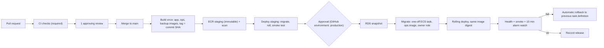

# Release pipeline (go-live on AWS ECS)

Status: **design for review (Phase 1)**. The current workflows (`ci.yml`, `deploy.yml`, `deploy-env.yml` for the
Lightsail pilot, `keep-render-awake.yml`) keep working unchanged until cut-over. New workflows are added next to them.
Architecture: [`GO_LIVE_ARCHITECTURE.md`](GO_LIVE_ARCHITECTURE.md).



## 1. Branches and protection

- Work on `feature/*`, `fix/*`, `backend/*` and so on (see `CONTRIBUTING.md`). Never commit straight to `main`.
- `main` is protected: required checks (section 2), 1 approving review, no force pushes, linear history optional.
- `CODEOWNERS`: `infra/**`, `db/**`, `migration/**`, `.github/workflows/**`, `src/lib/store/sql/**` need a review from
  the infra/database owner.
- **GitHub plan:** required reviewers on environments in a **private** repository need GitHub Team (or Enterprise).
  The go-live PDF already budgets GitHub Team (₹1,880/month for 5 users). Open question Q16.

## 2. Pull-request checks (`ci.yml`)

Existing jobs stay as they are. New jobs are marked **new**.

| Job | What it proves | Blocking |
|---|---|---|
| Typecheck, lint, test, build (exists) | `npm run typecheck`, `lint`, `test` (JSON store + embedded PostgreSQL), `build` | yes |
| Schema upgrade = fresh install (exists, `postgres:17`) | upgrading the base commit's database equals a fresh install; stock summary = recount | yes |
| **Old app on new schema** (new) | after the upgrade above, start the **base** commit's app against the upgraded database and run the API smoke script. Proves the expand/contract rule (section 6) mechanically | yes |
| **E2E on real PostgreSQL** (new) | Playwright demo and scanning specs against a `postgres:17` service (today `test:e2e:postgres` uses embedded PGlite) | yes |
| **v11 SQL checks** (new, once the v11 files are in the repo) | `bootstrap_aws.sql` → `schema_v11_aws.sql` (twice: re-runnable) → `roles_v11.sql` → `tests/sql/test_v11_life_of_a_tray.sql` as `velza_app` (34 checks); Supabase→v11 migration rehearsal (`tests/sql/make_fake_supabase_v10.sql` → `migration/01…04`); matrix `postgres:16` and `postgres:17` until the pilot is retired | yes |
| **schema.ts = v11 SQL** (new) | `db:fingerprint` of a fresh install from `schema.ts` equals one from `db/schema_v11_aws.sql`, so the two never drift | yes |
| Docker images + stack smoke test (exists) | builds the three images, runs the pilot stack | yes |
| **Image scan** (new) | `trivy image` on the three images built above: fail on CRITICAL with a fix available; HIGH reported | yes (critical) |
| **Dependency audit** (new) | `npm audit --omit=dev --audit-level=high` | yes |
| **Secret scan** (new) | `gitleaks` on the PR diff | yes |
| Terraform fmt + validate (exists) | pilot roots; formatting stays a warning there | yes |
| **Terraform for `infra/aws`** (new) | `terraform fmt -check` (blocking), `validate` per root, `trivy config infra/aws` (fail on HIGH), `terraform plan` per changed root using the read-only `velza-gha-tf-plan` role, plan posted as a PR comment | yes (plan job only when AWS exists) |

## 3. Build once (`release-build.yml`, new)

Trigger: `workflow_run` of CI on `main`, success only (and `workflow_dispatch` for a rebuild).

1. Check out the exact `head_sha`.
2. OIDC → `velza-gha-build` (staging account; trust limited to `ref:refs/heads/main`).
3. `docker buildx` the `app` and `ops` targets and `deploy/backup` with the GitHub Actions cache. Build args
   `HTTPS_ONLY=1`; `NEXT_PUBLIC_DEMO_HELPER` unset. Add OCI labels `org.opencontainers.image.revision=<sha>`.
4. Push `:<sha>` (ECR tag immutability on: a SHA can never be overwritten).
5. Wait for ECR basic scan results. Fail on CRITICAL. Record the three **digests** as the job output and as a GitHub
   deployment payload.
6. ECR replication copies the images to the production account (Mumbai) and on to Hyderabad within minutes. The
   production deploy waits for the digest to exist there.

## 4. Deploy to staging (`release-deploy.yml`, job `staging`, automatic)

GitHub environment `staging`, OIDC → `velza-gha-deploy-staging`. Concurrency group `deploy-staging` (never cancelled
halfway).

1. **Render task definitions** from `deploy/aws/taskdefs/*.json` templates with the image **digests**, `RELEASE_SHA`,
   and the env's ARNs (from Terraform outputs saved in Parameter Store `/velza/staging/infra/*`).
2. **Snapshot** (staging too, to rehearse the step): `aws rds create-db-snapshot velza-staging-pre-<sha7>`, wait.
3. **Migrate**: `aws ecs run-task` with `velza-ops-migrate` (ops image, `MIGRATE_DATABASE_URL`, command
   `npm run db:migrate`), then the roles step (`roles_v11.sql` via the backup image's `psql`). Wait for `STOPPED`,
   require `exitCode == 0`, stream the log to the job summary.
4. **Roll**: `aws ecs update-service --service app --task-definition <new>`. Rolling update with minimum 100 % /
   maximum 200 %: new tasks start and must pass the ALB health check before old ones drain (deregistration delay 30 s,
   app graceful shutdown C3). The deployment circuit breaker rolls back by itself if new tasks keep failing.
5. `aws ecs wait services-stable` (timeout 15 min).
6. **Smoke test** (`deploy/aws/smoke.sh`, new): `/api/health` returns this `RELEASE_SHA` and `db: ok`; sign in as the
   staging smoke user; read-only API calls (dashboard, lookup of a seeded code, public QR lookup); one write on a
   dedicated smoke partner (scan of a seeded code), so the database write path is tested.
7. Record `/velza/staging/release/current = <sha>` and the previous value in `…/previous`.

## 5. Deploy to production (`release-deploy.yml`, job `production`)

GitHub environment `production`: **required reviewers** (the release approvers), deployment branch `main` only.
OIDC → `velza-gha-deploy-prod`. Concurrency group `deploy-prod`.

1. **Preflight**: the SHA must be the one staging just ran successfully (`/velza/staging/release/current`); the
   digests must exist in the prod ECR replica; no production alarm in `ALARM` state (otherwise stop and ask).
2. **Snapshot**: `velza-prod-pre-<sha7>-<yyyymmddhhmm>`, wait until `available`. Snapshots are incremental, so
   minutes, not hours. A scheduled cleanup removes `pre-*` snapshots older than 14 days (manual snapshots count
   toward backup storage).
3. **Migrate**: same one-off task as staging, on production. The app keeps serving on the old release while this runs
   (that is why every migration must be backward compatible). If the task fails: stop. Nothing else changed; the old
   release keeps serving; fix forward.
4. **Rolling deploy** with the same digest that passed staging.
5. **Health check**: `services-stable`, `/api/health` shows the new `RELEASE_SHA` on every task (polled through the ALB
   several times), the smoke script in **read-only** mode (no writes in production).
6. **Watch 10 minutes**: the workflow polls the 5xx-rate and p95 alarms. If either goes to `ALARM`, the workflow
   rolls back automatically (step 8).
7. Record `/velza/prod/release/current` and `…/previous`; write the GitHub deployment status and a job summary.
8. **Rollback** (automatic on failure in 5–6, or by hand):

   ```bash
   # one command, from a laptop with the Deploy role or from Actions → "Rollback" (workflow_dispatch)
   deploy/aws/rollback.sh production            # previous release recorded in Parameter Store
   deploy/aws/rollback.sh production <sha>      # or a specific release
   ```

   It re-registers the task definition that points at the older digest and runs `update-service`. No build and no
   migration: older code runs on the newer schema by design. The app already logs a warning in that case
   (`warnNewerSchema` in `sqlStore.ts`).

## 6. Database migrations: expand / contract

Every schema change ships in a release that still works with the **previous** release's code:

| Change | Release N (expand) | Release N+1 or later (contract) |
|---|---|---|
| Add a column | add it nullable, or with a default; code writes it and tolerates NULL | add `NOT NULL` once filled |
| Rename a column | add the new column, write both, read new with fallback, backfill in batches | drop the old column |
| Drop a column / table | stop reading and writing it | drop it |
| New index on a big table | per partition, `CREATE INDEX CONCURRENTLY`, then attach to the parent; `SET lock_timeout = '5s'` and retry | — |
| New constraint | `NOT VALID`, then `VALIDATE CONSTRAINT` in the same or a later release (existing pattern from v10) | — |

Rules the migration tool and review enforce:

- `npm run db:migrate` runs as `velza_owner` with `lock_timeout = 5s` and `statement_timeout = 0`. A lock it can't get
  fails the deploy fast instead of blocking scans.
- Long backfills don't run in the deploy. They run as a separate job in batches.
- The app never runs DDL in production (`VELZA_SCHEMA_AUTO=off`, app change C10), even if it starts before the
  migration has finished.
- CI's *old app on new schema* job (section 2) proves the rule for every PR.

**The v10 → v11 move is the one exception.** It is a new database (16 hash partitions, monthly history partitions,
uuid ids). It can't be done as expand/contract on a live table, so it happens once, at cut-over, in a maintenance
window (`GO_LIVE_APP_CHANGES_AND_PLAN.md` §C11).

## 7. Infrastructure changes

`infra-plan.yml` (new): on every PR touching `infra/aws/**`, a plan per changed root, posted as a comment.
`infra-apply.yml` (new): on merge, apply `staging` roots through the `infra-staging` environment (one reviewer);
`prod` roots through `infra-prod` (one reviewer, not the PR author). A plan that **destroys or replaces** RDS, a KMS
key, a bucket or a state bucket fails the job. `prevent_destroy` is set on all of those as well.

Until you approve, the apply jobs exist but have no AWS role to assume, so they can't change anything.

## 8. Runbooks (written in Phase 9)

`docs/runbooks/`: `deploy.md`, `rollback.md`, `restore-from-pitr.md`, `region-failover-hyderabad.md`,
`rotate-secrets.md`, `monthly-restore-test.md`, `break-glass.md`, `archive-history-month.md`. Each has a "how to
check it worked" section and the expected duration, filled in from the first drill.
