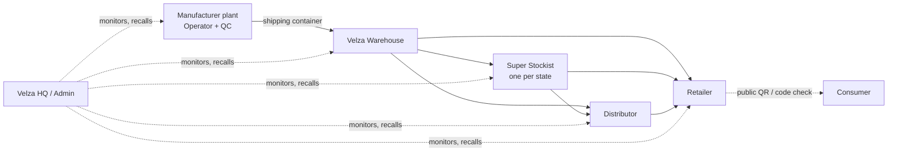
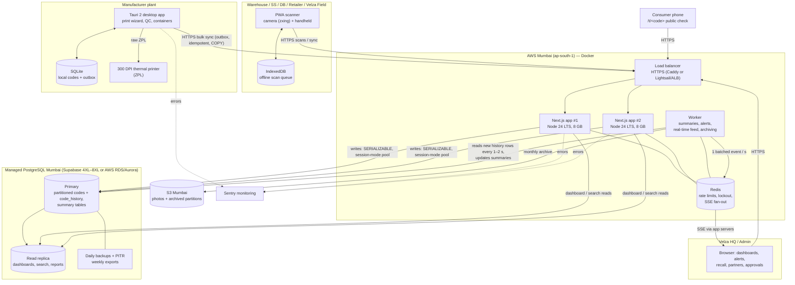
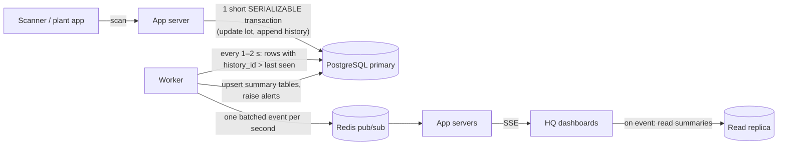
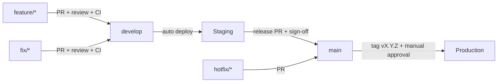
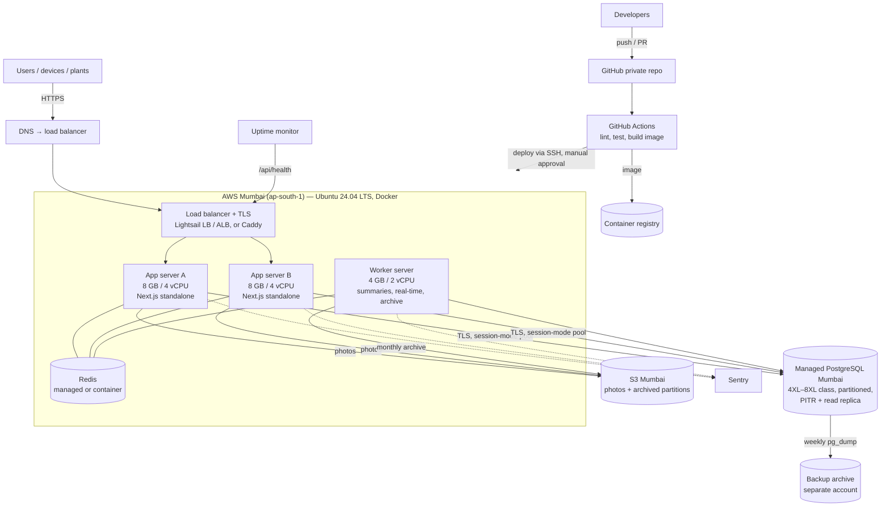
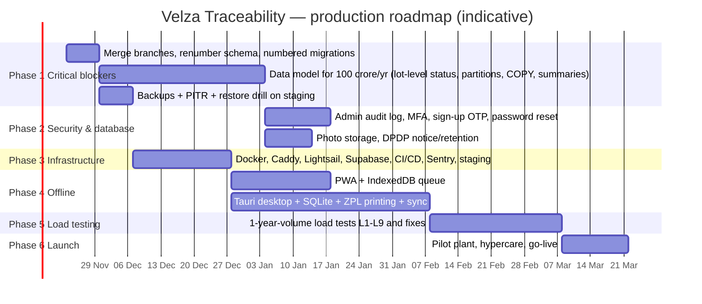

# Velza Traceability System — Final Technical Architecture and Production Readiness

| | |
|---|---|
| **Document type** | Technical audit, architecture validation and production-readiness assessment |
| **Audience** | Velza senior management, IT review |
| **Codebase audited** | `crms_velza_trace` (GitHub `AbhayVelza/crms_velza_trace`), branch `develop/aditya`, commit `42ae268`, 14 Nov 2026 |
| **Method** | Read-only inspection of source code, configuration, schema, tests and existing project documents. No code, dependency, infrastructure or data was changed. No load test was run for this document. |
| **Evidence convention** | **[Verified]** = seen in the code or configuration, with file reference. **[Measured]** = a number from an earlier recorded test (source given). **[Assessment]** = the auditor's engineering judgement. **[Recommendation]** = proposed, not built. |
| **Revision** | **Rev 2 (14 Nov 2026):** re-sized for the confirmed business volume of **100 crore (1,000,000,000) barcodes printed per year**, with real-time database updates. Server setup re-checked (still none in the repository). Changes in Sections 1, 5, 6, 7, 8.6, 12, 13, 14, 16–19. |
| **Design volume** | **100 crore barcodes / year** (every printed lot and pack label is one barcode). The earlier "1.2 million per consignment" figure is now one consignment within this annual volume. |

> **Scope note.** The branch `features/barcode-history` contains further work that is **not** on `develop/aditya`: Product details page, Returns (Velza Field Staff role, warehouse inspection), camera fixes and five UI fixes. Statements below describe `develop/aditya` unless marked otherwise. The two branches must be merged before release (both use database schema version 6 — one must be renumbered).

---

## 1. Executive Summary

**Decision in one line:** the application is a well-engineered, well-tested **functional prototype** of the complete traceability workflow, but it is **not ready for production approval**. Most of the proposed production stack (desktop app, offline storage, real-time push, thermal-printer output, hosting, CI/CD, monitoring, backups) has **not been built yet**, and performance at the required volume has **not been proven**.

**What is solid today [Verified]**

- One web application (Next.js 16.4.3, React 19.3, TypeScript, Tailwind 4) covering every role: Velza Admin, HQ, Manufacturer Operator, QC, Velza Warehouse, Super Stockist, Distributor, Retailer (+ self sign-up for SS/DB/Retailer, approval for SS/DB).
- Correct business rules for the full chain: print → QC verify → container → warehouse → SS/DB/Retailer, with recall, quarantine, void, reprint, damage, alerts and a public product-check page.
- A strong data core on PostgreSQL: unique codes enforced by primary key and CHECK constraints, SERIALIZABLE transactions with retry, an **append-only** audit ledger enforced by a database trigger, protection against deleting issued codes.
- Good security fundamentals: scrypt passwords, hashed session tokens, HttpOnly cookies, role-based permissions checked on every API call, CSRF and rate-limit guards, parameterised SQL, security headers.
- 36 unit-test files (~460 test cases, run against both storage engines) and 19 browser end-to-end tests, all passing on 14 Nov 2026.

**What blocks production [Verified]**

| # | Critical blocker | Why it matters |
|---|---|---|
| 1 | **No real offline mode.** "Offline" is a server-side flag for demonstration; no desktop app, no SQLite, no PWA, no IndexedDB. | A plant internet outage stops printing; field scanning needs connectivity. |
| 2 | **Performance at volume not proven; known slow paths.** Measured 100k-code test: HQ dashboard 1.6 s alone, 11 s with 10 users. Dashboard, alerts and scan-audit read entire tables into memory. | Requirement is **100 crore (1 billion) barcodes per year** — ≈ 10,000× the largest dataset ever tested; the current design will degrade long before that. |
| 3 | **No hosting, deployment, CI/CD, monitoring or backups exist.** No Dockerfile, Compose, Caddy, GitHub Actions, Sentry, health check or backup job. Live data was lost once (30 Oct 2026) with no backup. | Cannot operate, update or recover a production system safely. |
| 4 | **No thermal-printer (ZPL) output.** Labels are printed through the browser print dialog at millimetre sizes. | Industrial 300 DPI label printing needs ZPL for reliable, fast output. |
| 5 | **No real-time push.** HQ dashboard polls every 15 s; no LISTEN/NOTIFY or Server-Sent Events. | Not the approved design; at 100 crore barcodes/year real-time must come from pre-computed summaries, not table scans. |
| 6 | **Data model not sized for 100 crore barcodes/year.** Every move updates each pack row one by one; no table partitioning; no archiving; multi-row INSERT instead of bulk COPY. | ≈ 11 billion row updates and ≈ 3–4 billion history rows per year; ≈ 1.5–2.5 TB of new data per year (Section 8.6). |

**Volume this system must carry (Rev 2) [Assessment, from the code's data model]:** 100 crore barcodes/year ≈ **3.3 million labels per production day**, ≈ **14–20 crore cases/trays per year**, ≈ **250 crore scan/API requests per year** (≈ 200 requests/s sustained in working hours, ≈ 600/s at peak), ≈ **1.5–2.5 TB new database storage per year**.

**Server and database verdict (Rev 2):** the proposed **2 GB Lightsail server is not sufficient** for this volume — it is suitable for the pilot only. Production needs **at least two application servers (8 GB / 4 vCPU each) behind a load balancer, a background worker, Redis, and a large managed PostgreSQL (Supabase 4XL–8XL class or AWS RDS/Aurora in Mumbai) with partitioned tables** (Sections 8.6, 12.3).

**Recommendation:** **approve the target architecture** (Section 18) and a **phased build-out of about 20–26 weeks** (Section 17) before go-live, with a controlled **pilot** possible earlier on a single plant once Phases 1–3 are complete. Do **not** approve production launch on the current build.

---

## 2. Project Overview

**Business purpose.** Velza needs end-to-end traceability of every case, tray and pack of its beverages from the manufacturing plant to the retailer: who made it, which batch, manufacture/expiry dates, where it is now, who handled it, and the ability to recall a batch and detect counterfeit or misdirected stock.

**Supply chain modelled [Verified — `src/lib/core/types.ts`, `WORKING_MODEL.md`]**



**Units and codes [Verified — `src/lib/core/codes.ts`]**

| Unit | Contents | Code | Example structure |
|---|---|---|---|
| Case | 4 packs × 6 cans | 15-character lot code | Country(2) + Batch(6) + Flavour(2) + Lot number (5 hex) |
| Tray | 6 packs × 4 cans | 15-character lot code | same |
| Pack | inside a case/tray | 17-character pack code | Lot code + pack size + sequence |

**Project size [Verified]:** 176 TypeScript source files (~20,500 lines), 47 API routes, 30 screens, 38 test files, 44 commits since 24 Oct 2026. The project README describes itself as a **prototype**.

---

## 3. Existing System Audit

### 3.1 Structure [Verified]

| Area | Location | Notes |
|---|---|---|
| Screens (UI) | `src/app/(screens)/…`, `src/app/login`, `signup`, `print`, `t/[code]` | Role-specific portals; public product page `/t/<code>` |
| API | `src/app/api/**/route.ts` (47 routes) | Thin handlers; all logic in services |
| Business logic | `src/lib/services/*.ts` | admin, auth, containers, damage, movement, operator, pool, printOrders, signup, trace, verify |
| Domain rules | `src/lib/core/*.ts` | code format, permissions matrix, status rules |
| Storage | `src/lib/store/` | `jsonStore.ts` (single JSON file), `sql/sqlStore.ts` + `driver.ts` + `schema.ts` (PostgreSQL / PGlite) |
| Schema export | `db/schema.sql` (generated, v6) | |
| Scripts | `scripts/` | seed, migrate, schema export, JSON→Postgres import, clear-activity |
| Tests | `tests/unit`, `src/**/*.test.ts`, `tests/e2e`, `tests/qa` | Vitest, Playwright, performance harnesses |
| Docs | `README.md`, `SECURITY.md`, `ASSUMPTIONS.md`, `WORKING_MODEL.md`, `docs/*.md` | Includes a measured scalability report |

### 3.2 What each part of the proposed stack looks like in the code

| Proposed item | Found in code? | Evidence |
|---|---|---|
| Next.js App Router, React, TypeScript, Tailwind | **Yes** | `package.json`: next 16.4.3, react 19.3.0, typescript 5.9.3, tailwindcss 4.3.3 |
| Next.js route handlers on Node.js LTS | **Yes** (Node version **not pinned**) | No `engines` field / `.nvmrc`; README says Node 24, dev machine runs 22.13.1 |
| PostgreSQL | **Yes, optional** | Enabled by `DATABASE_URL`; default without it is a JSON file (`src/lib/store/index.ts:26-30`) |
| Supabase Pro (Mumbai) | **No** Supabase-specific code (plain `pg` driver — compatible) | `src/lib/store/sql/driver.ts:74` |
| LISTEN/NOTIFY + SSE | **No** — polling every 15 s | `src/app/(screens)/hq/page.tsx:27` |
| PWA | **No** manifest or service worker | `public/` contains default icons only |
| @zxing/browser camera scanning | **Yes** (in a normal web page) | `src/lib/scan/camera.ts`, `src/components/ScanInput.tsx` |
| Handheld scanners (keyboard wedge) | **Yes** | `ScanInput.tsx` queues fast scanner input |
| IndexedDB offline queue | **No** | no `indexedDB`/`idb` usage in `src` |
| Tauri 2 desktop + SQLite | **No** | no `src-tauri`, no SQLite package |
| Offline/sync | **Simulated** only (flag on device record) | `src/lib/services/operator.ts:135-178`, `ASSUMPTIONS.md` |
| bwip-js barcodes | **Yes** — Code 128 as SVG | `src/lib/barcode.ts:5` |
| ZPL / 300 DPI thermal printing | **No** — browser `window.print()` with mm-sized CSS pages | `src/components/PrintView.tsx:129`, `Stickers.tsx:105-113` |
| Docker / Compose / Caddy / Lightsail | **No** | no files present |
| GitHub Actions | **No** | no `.github` folder |
| Vitest + Playwright | **Yes** | `vitest.config.mts`, `playwright.config.ts` |
| Sentry / monitoring | **No** | no package, no health endpoint |
| Backups | **No** automated backups | manual JSON copies only; `docs/CRMS_STATUS.md` §7 |
| Application-managed auth + RBAC | **Yes** | `src/lib/services/auth.ts`, `src/lib/core/permissions.ts` |

---

## 4. Current Technology Stack (verified)

| Layer | Technology in use | Version | Evidence |
|---|---|---|---|
| UI framework | Next.js (App Router, Turbopack) | 16.4.3 | `package.json` |
| UI library | React / React DOM | 19.3.0 | `package.json` |
| Language | TypeScript (strict) | 5.9.3 | `node_modules/typescript` |
| Styling | Tailwind CSS (+ @tailwindcss/turbopack) | 4.3.3 | `package.json` |
| Validation | zod | 4.6.7 | services (`*Schema`) |
| Backend | Next.js Route Handlers on Node.js | Node not pinned (22.13.1 on dev PC) | `src/app/api` |
| Database (production mode) | PostgreSQL via `pg` | pg 8.23.1; tested on PostgreSQL 17.3 | `src/lib/store/sql/driver.ts` |
| Database (tests / trial) | PGlite (embedded PostgreSQL in WebAssembly) | 0.5.11 | `src/lib/store/index.ts:52-55` |
| Database (default dev) | Single JSON file `data/db.json` | — | `src/lib/store/jsonStore.ts` (header: not for production) |
| Barcode generation | bwip-js (Code 128, SVG) | 4.11.4 | `src/lib/barcode.ts` |
| Barcode reading | @zxing/browser + @zxing/library | 0.2.1 / 0.23.0 | `src/lib/scan/camera.ts` |
| Printing | Browser print dialog, CSS `@page` sizes in mm | — | `PrintView.tsx`, `Stickers.tsx` |
| Auth | Own implementation: scrypt, hashed session tokens, RBAC | Node `crypto` | `src/lib/passwords.ts`, `auth.ts` |
| Real-time | Polling (15 s) + in-tab event bus | — | `hq/page.tsx:27`, `src/lib/events.ts` |
| Unit / integration tests | Vitest (JSON + PGlite projects) | 5.0.5 | `vitest.config.mts` |
| End-to-end tests | Playwright | 1.64.1 | `playwright.config.ts` |
| Hosting, CI/CD, monitoring, backups | **None** | — | — |

---

## 5. Proposed Final Technology Stack

The baseline proposed by management, with the auditor's verdict. Detail and reasoning are in Section 6.

| Layer | Proposed technology | Verdict | Note |
|---|---|---|---|
| Frontend | Next.js App Router, React, TypeScript, Tailwind | **KEEP** | Already built |
| Backend | Next.js Route Handlers, Node.js LTS | **KEEP / IMPROVE** | Pin Node 24 LTS |
| Database | PostgreSQL — Supabase Pro, Mumbai | **KEEP (ADD) — size up** | Code is Postgres-ready; use Supabase **session-mode / direct connection**; at 100 crore barcodes/year needs a **4XL–8XL class compute**, partitioned tables, PITR and a read replica (Section 8.6) — or AWS RDS/Aurora PostgreSQL Mumbai |
| Real-time | PostgreSQL LISTEN/NOTIFY + SSE | **ADD — changed design** | **No NOTIFY per scan** (NOTIFY takes a global lock at commit and would serialise ~600 writes/s). A background worker reads new history rows every 1–2 s, updates summary tables and pushes via SSE (Section 8.6) |
| Scan application | PWA, @zxing/browser | **IMPROVE** | Scanner exists; make it an installable PWA |
| Offline scan storage | IndexedDB | **ADD** | |
| Manufacturer desktop | Tauri 2 | **ADD** | Only needed for true offline printing at plants |
| Desktop offline database | SQLite | **ADD** | Paired with Tauri |
| Barcode generation | bwip-js | **KEEP** | Can also produce printer-native output |
| Label printing | 300 DPI thermal transfer, ZPL | **ADD** | Requires printer-model confirmation |
| Hosting | AWS Lightsail Mumbai, 2 GB / 2 vCPU / 60 GB | **ADD — size up substantially** | 2 GB = pilot only. Production at 100 crore barcodes/year: **2+ app servers of 8 GB / 4 vCPU behind a load balancer + a worker server + Redis** (Section 12.3); AWS EC2/ECS Mumbai preferred once auto-scaling is needed |
| Containers | Docker + Docker Compose | **ADD** | |
| Reverse proxy | Caddy (automatic HTTPS) | **ADD** | Must set `CLIENT_IP_HEADER`, `HTTPS_ONLY=1` |
| Authentication | Application-managed auth + RBAC | **KEEP / IMPROVE** | Add MFA for Admin/HQ, admin audit log |
| CI/CD | GitHub Actions + private repository | **ADD** | |
| Testing | Vitest + Playwright | **KEEP / IMPROVE** | Add real-PostgreSQL CI job and load tests |
| Monitoring | Sentry | **ADD** | Plus uptime check + health endpoint |
| Backup | Supabase daily + weekly exports | **ADD — strengthen** | Add Point-in-Time Recovery (PITR) and restore drills |

---

## 6. Technology Justification and Compatibility

### 6.1 Per-technology evaluation

| Technology | Role in Velza | Why suitable | Compatible with | Limitations | Decision | Production changes required |
|---|---|---|---|---|---|---|
| **Next.js 16 (App Router)** | All screens and the API in one app | One codebase for every role; server-side checks; mature ecosystem | Node, PostgreSQL, Caddy, Docker, PWA | Long-lived connections (SSE) need care in a standalone server; large framework upgrades every year | **KEEP** | `output: "standalone"` build for Docker; pin version; CSP nonces later |
| **Node.js LTS** | Runtime for the app | Required by Next.js; stable LTS | All of the above | Not pinned today | **IMPROVE** | Add `engines` + `.nvmrc` (Node 24 LTS); same version in Docker and CI |
| **PostgreSQL** | System of record | Strong constraints, SERIALIZABLE transactions, triggers (already used for append-only history and code protection) | Supabase, `pg` driver, LISTEN/NOTIFY | Current queries load whole tables in several places | **KEEP** | Indexes and server-side aggregation (Section 8), statement timeouts, connection-pool sizing |
| **Supabase Pro (Mumbai)** | Managed PostgreSQL | Managed backups, PITR add-on, India region, dashboards | Plain PostgreSQL protocol — no code change needed | **Transaction-mode pooler (port 6543) is not compatible** with session advisory locks (`pg_try_advisory_lock`, used for code allocation) and with LISTEN; extra cost for PITR and compute; per Supabase docs the largest tier is 64 vCPU / 256 GB with a recommended maximum database size of 10 TB — about 4–5 years of hot data at this volume without archiving | **KEEP (ADD) — large tier** | **Session pooler or direct connection**; start at a **4XL-class** compute (scale to 8XL by measured load), high-performance disk/IOPS, PITR, 1 read replica for dashboards/search; size so `PG_POOL_MAX` × app instances < connection limit; keep **AWS RDS/Aurora PostgreSQL (Mumbai)** as the fallback if IOPS or disk limits are reached |
| **LISTEN/NOTIFY + SSE** | Push dashboard/alert updates | Built into PostgreSQL; SSE is one-way and simple over HTTPS | Next.js route handlers (streaming), Caddy (supports SSE) | **A transaction that calls NOTIFY takes a database-wide lock at commit**, serialising all such commits — unusable per scan at ~600 writes/s; payload ≤ 8 KB | **ADD — batched only** | Scans never NOTIFY. One worker emits **at most one NOTIFY per second** (or the worker pushes directly via Redis pub/sub); SSE to browsers; 15-s polling as fallback |
| **PWA + @zxing/browser** | Camera/handheld scanning on phones and tablets | Installable, works offline with a service worker; zxing already integrated and tested | Next.js, IndexedDB | iOS limits background sync; camera needs HTTPS | **IMPROVE** | Add manifest, service worker, offline shell; use explicit "Sync now" on iOS |
| **IndexedDB** | Offline scan queue on devices | Durable browser storage, large capacity | PWA | Can be cleared by the user/OS; needs idempotent replay | **ADD** | Each queued scan carries a client-generated unique ID for duplicate-safe replay |
| **Tauri 2** | Plant desktop for offline code generation and printing | Small footprint, native printer access (raw ZPL to USB/network printers), Rust security model | SQLite, Next.js UI (can reuse web screens), ZPL | Separate build/sign/update pipeline per OS; Rust skills needed | **ADD** | Code signing, auto-update channel, device registration with the existing batch-code pool |
| **SQLite** | Local database inside the desktop app | Reliable, single-file, transactional | Tauri | Not shared between PCs; must sync | **ADD** | Outbox table with sequence numbers; server reconciliation |
| **bwip-js** | Barcode generation | Pure JS, Code 128 tested; also renders other symbologies | Browser, Node, Tauri | SVG for browser printing is not ideal for thermal printers | **KEEP** | For thermal printing, send **ZPL** (printer draws the barcode natively) or 300 DPI bitmaps |
| **ZPL thermal printing (300 DPI)** | Industrial labels | Fast, durable, exact barcode quality | Tauri (raw printing) or network printers (port 9100) | Browsers cannot send raw ZPL; printer-model specifics | **ADD** | Template per label size; verify barcode grade (ISO/IEC 15416) on real printers |
| **Docker + Compose** | Packaging and running the app | Reproducible builds, easy rollback by image tag | Lightsail, Caddy, GitHub Actions | Needs log rotation and disk management | **ADD** | Multi-stage Dockerfile, non-root user, health check |
| **Caddy** | HTTPS, reverse proxy | Automatic certificates, simple config, supports SSE streaming | Docker, Lightsail | Must pass correct client IP | **ADD** | Set `CLIENT_IP_HEADER`, `HTTPS_ONLY=1`, compression, request size limit ≥ 9 MB for damage photos |
| **AWS Lightsail (Mumbai)** | App hosting | Low, predictable cost; India region; has load balancers | Docker, Caddy, Supabase | Single VM = single point of failure; no auto-scaling | **KEEP for pilot; production = 2+ instances + LB** | Snapshots, static IP, firewall (80/443 only); at 100 crore barcodes/year 2× 8 GB app + worker + Redis; move to EC2/ECS if load needs auto-scaling |
| **GitHub Actions** | CI/CD | Integrated with the private repo | Docker, Vitest, Playwright | Minutes cost on private repos | **ADD** | Lint, typecheck, unit (JSON + PostgreSQL), e2e, image build, deploy with approval |
| **Vitest + Playwright** | Automated quality gate | Already extensive and passing | CI | "Postgres" test project uses PGlite (single connection), not a real server | **KEEP / IMPROVE** | Add a real PostgreSQL 17 service in CI and a load-test suite |
| **Sentry** | Error and performance monitoring | Standard for Next.js | Next.js, Tauri | Must scrub personal data | **ADD** | Server + browser SDK, release tracking, PII scrubbing |

### 6.2 Compatibility summary

All proposed components are **mutually compatible** with one important configuration rule:

> **[Verified + Assessment]** The application relies on **SERIALIZABLE transactions** (`driver.ts:104`) and **session-level advisory locks** (`driver.ts:90-102`, used to allocate codes per manufacturer). These do **not** work through a *transaction-mode* connection pooler (Supabase/PgBouncer port 6543). The production connection must use Supabase's **session mode** or a **direct connection**, and LISTEN/NOTIFY needs its own dedicated direct connection.

No proposed technology needs to be **replaced**. The JSON file store must simply **never be used in production** (its own header says so).

> **[Assessment — Rev 2]** At **100 crore barcodes/year** two parts of the proposed stack change from "configure" to "redesign": (1) **real-time** cannot use one NOTIFY per scan — it must be batched by a worker; (2) the **single 2 GB server** must become a small cluster (2+ app servers, worker, Redis, load balancer). The technologies stay the same; their deployment shape and the data model change.

---

## 7. Complete System Architecture

### 7.1 Today (verified)

One Next.js web application serves every role. Business rules live in `src/lib/services`; storage is pluggable (JSON file, PGlite, or PostgreSQL).

### 7.2 Target architecture (recommended)



### 7.3 Components and status

| Component | What it does | Status |
|---|---|---|
| **HQ Admin & Dashboard** | Partners, sign-ins, devices, reference data, batch-code pools, settings, approvals; HQ dashboard, search with full timeline, alerts, batch report and recall, scan audit | **Built** (web). Dashboard does full-table reads — must be optimised |
| **Manufacturer application** | Print-order wizard (new / continue batch), codes, print view, reprint (logged, once), void, containers, dispatch to warehouse, device bar (simulated offline) | **Built as web app**; Tauri desktop, SQLite, ZPL **not built** |
| **QC (Supervisor)** | Verify a lot by scanning lot + every pack → PACKED or QUARANTINED | **Built** |
| **Velza Warehouse** | Receive containers by container number, dispatch to SS/DB/Retailer | **Built** |
| **Stockist / Distributor / Retailer** | Receive, dispatch (to assigned partners only), stock, open lot (retailer), damaged reports with photos, assigned partners list; self sign-up | **Built** |
| **Velza Field application** | Take back stock, product details | **Built on `features/barcode-history` only** — not on `develop/aditya` |
| **Barcode & QR scanning** | Camera (zxing, rotated barcodes) and keyboard-wedge scanners; format check before sending | **Built** (web, not PWA) |
| **Product traceability** | Full timeline per code; public check page with recall warning | **Built** |
| **Batch & unique code generation** | Random 6-char batch codes from a per-device pool; atomic lot counters; codes unique by primary key; idempotent print orders | **Built**; capacity limits in Section 13 |
| **Inventory movement** | Dispatch / receive / open lot / damage / recall with status rules, wrong-receiver detection | **Built** |
| **Offline operations** | Real offline printing and scanning | **Not built** (simulation only) |
| **Central database** | PostgreSQL schema v6 with constraints and triggers | **Built**; not yet hosted |
| **Real-time dashboard** | Push updates | **Not built** (15-s polling) |

### 7.4 Request flow (example: a distributor receives a case) [Verified]

1. Scanner input → `ScanInput` checks code format → `POST /api/receive`.
2. `handler()` (`src/lib/api.ts`) applies rate limits, cross-site check, resolves the session.
3. Service `movement.ts` → `loadActor` + `requireAction` (role and partner active) → opens a **SERIALIZABLE** transaction.
4. Reads the code's status, applies the rule (must be IN_TRANSIT to this partner; else WRONG_RECEIVER alert), updates lot + packs, appends to the **append-only** `code_history`.
5. Commit (automatic retry on serialization conflict, up to 5 times).

---

## 8. Database Architecture

### 8.1 Schema (version 6) [Verified — `src/lib/store/sql/schema.ts`, `db/schema.sql`]

| Table | Purpose | Key integrity rules |
|---|---|---|
| `partners` | MF, VW, SS, DB, RT sites | ID prefix must match tier; **one SS per state** (partial unique index, rejected sign-ups excluded); `approval` (NULL/PENDING/REJECTED) |
| `users` | Sign-ins | ID format check; role check |
| `sessions` | Active sessions | stores **SHA-256 of token** only |
| `codes` | Every lot (case/tray) **and** pack | **`code` PRIMARY KEY** (uniqueness); CHECK that code = its parts; pack sequence rules; status enum; issued codes cannot be deleted or renamed (trigger) |
| `code_history` | Movements, scans, reprints (the audit ledger) | **append-only** trigger (no UPDATE/DELETE); `event_id` unique |
| `batches`, `batch_code_pool` | Batch codes, per-device reserved pool | `batch_code` unique; lot counter can never go backwards (trigger) |
| `print_orders` | Print orders | primary key = idempotency key; request fingerprint |
| `containers` | Plant → warehouse shipping containers | one active container per number (partial unique index) |
| `devices`, `countries`, `flavours`, `settings`, `id_counters`, `schema_info` | Reference and configuration | |

**Migrations [Verified]:** one idempotent SQL script, re-applied when `schema_info.version` differs, or by `npm run db:migrate`. There are **no numbered, reversible migrations**. [Recommendation] adopt numbered migrations (e.g. node-pg-migrate or Supabase migrations) before production so every change is reviewed, versioned and repeatable.

### 8.2 Transactions and concurrency [Verified]

- Every write transaction runs at **SERIALIZABLE** isolation with retry on `40001`/`40P01` (5 attempts) — `driver.ts:104-117`.
- Code allocation per manufacturer is serialised with a **session advisory lock** (30 s wait) — `driver.ts:90-102`, `printOrders.ts:139`.
- Lot numbers come from an atomic `UPDATE … RETURNING` counter — `sqlStore.ts:521-530`.
- Duplicate scans: two concurrent receives of the same code conflict; the retry sees the new status and the business rule rejects the second. No row locks are used.
- Connection pool: `pg.Pool` with `PG_POOL_MAX` default **10**; **no statement timeout** configured.

### 8.3 Indexing [Verified]

`codes`: lot_code, batch_code, (location_id, status), in-transit partial index, print_order_id, (manufacturer_id, code_type), unsynced partials. `code_history`: code, (record_type, event), login_id, location_id, event_time. **Missing:** index for alert queries on `code_history(ok, context)`.

### 8.4 Query patterns that will not scale [Verified]

| Rank | Where | Problem |
|---|---|---|
| 1 | HQ dashboard (`trace.ts:187-191`) | Loads **every lot and pack** into memory, filters in JavaScript |
| 2 | Scan audit (`trace.ts:647-649`) | Loads the **whole scan ledger** to show the latest 300 |
| 3 | Alerts (`trace.ts:244-257`) | Loads all failed scans, public scans and damage events; no supporting index |
| 4 | Batch list / report (`trace.ts:523-557`) | Loads all lots and all reprints |
| 5 | Recall (`trace.ts:588-601`) | Updates lot by lot and pack by pack in one transaction — a 99,999-lot batch ≈ 500k–700k statements |
| 6 | Container dispatch (`containers.ts:180-205`) | ≈ 2,860 lots × ~15 statements in one SERIALIZABLE transaction |
| 7 | General | No `COUNT`, `GROUP BY` or `LIMIT` pushed to the database anywhere; no pagination |

[Recommendation] Move aggregation into SQL (`GROUP BY status, location`), add `LIMIT`/keyset pagination, add missing indexes, and implement **set-based** updates for recall, container dispatch and lot moves (one `UPDATE … WHERE lot_code = ANY($1)` instead of per-row statements).

### 8.5 Backups and recovery [Verified]

No automated backup, PITR or standby exists. Seed and clear-activity scripts write a protective JSON snapshot before destructive actions. **Live data was lost on 30 Oct 2026 with no backup** (`docs/CRMS_STATUS.md`). [Recommendation] Supabase daily backups **plus PITR**, weekly `pg_dump` export to separate storage (e.g. S3 Mumbai with versioning), damage-photo storage backed up separately, and a **quarterly restore drill**.

### 8.6 Database design for 100 crore barcodes per year (Rev 2)

#### 8.6.1 What 100 crore barcodes/year means for the database

Inputs [Verified in code]: a case = 5 barcodes (1 lot + 4 packs), a tray = 7; every lot and pack is a row in `codes`; every status change, movement and scan appends to `code_history`; when a lot moves, **each pack row is also updated one by one** (`src/lib/services/common.ts:165-178`). Assumptions [Assessment]: 50/50 case/tray mix (≈ 6 barcodes per lot), 300 production days, scanning concentrated in 12 working hours, peak = 3 × average, chain MF → Warehouse → SS → DB → Retailer (4 hand-overs).

| Quantity | Per year | Per production day | Per second (working hours avg → peak) |
|---|---|---|---|
| Barcodes printed (= `codes` rows inserted) | **100 crore (1.0 B)** | ≈ 33 lakh (3.3 M) | ≈ 58/s over 16 h printing → ≈ 175/s peak |
| Cases/trays (lots) | ≈ 14–20 crore (143–200 M) | ≈ 5.5 lakh | — |
| Batches needed (≤ 99,999 lots each, `core/codes.ts:11`) | ≥ 1,430–2,000 | ≈ 5–7 | — |
| Print orders (≤ 10,000 lots each) | ≥ 14,300–20,000 | ≈ 50–70 | — |
| Shipping containers (≤ 2,860 lots) | ≈ 50,000–70,000 | ≈ 170–230 | — |
| Scan / movement API requests (QC + load + 4 × dispatch/receive ≈ 15 per lot) | ≈ 250 crore (2.5 B) | ≈ 83 lakh | **≈ 200/s → ≈ 600/s peak** |
| Row updates on `codes` — **current design** (≈ 11 status changes × lot + every pack) | **≈ 1,100 crore (11 B)** | ≈ 3.7 crore | ≈ 850/s → **≈ 2,500/s peak** |
| Row updates on `codes` — **recommended design** (lot-level status, below) | ≈ 180 crore (1.8 B) | ≈ 61 lakh | ≈ 140/s → ≈ 425/s peak |
| `code_history` rows appended (≈ 20–25 per lot incl. scans) | **≈ 300–400 crore (3–4 B)** | ≈ 1–1.3 crore | ≈ 300/s → ≈ 900/s peak |
| New storage incl. indexes [estimate ± 50 %] | **≈ 1.5–2.5 TB** | ≈ 5–8 GB | — |

> These are planning estimates from the current data model. They must be confirmed by generating ≥ 1 crore (10 M) sample rows on the target database and measuring table and index sizes and write rates (load tests L1–L4, Section 13.3).

#### 8.6.2 Required database design changes

| # | Change | Why | Effect |
|---|---|---|---|
| DB1 | **Lot-level status:** a pack's location and status follow its lot until the lot is opened; pack rows are written only when a lot is opened, damaged or recalled at pack level | Today every lot move rewrites 4–6 pack rows individually | ≈ **6× fewer row updates** (11 B → 1.8 B per year), far less WAL and table bloat |
| DB2 | **Partition `code_history` by month** (range on `event_time`), BRIN index on time, fewer B-tree indexes per partition | 3–4 B rows/year in one table cannot be maintained (vacuum, index rebuilds) | Old months become read-only; queries on recent data stay fast; archiving = detach a partition |
| DB3 | **Partition `codes` by batch** (hash on `batch_code`, e.g. 64 partitions; key `(batch_code, code)`; the batch code is characters 3–8 of every code, so lookups prune to one partition) | 1 B new rows/year | Smaller indexes per partition; parallel maintenance; batch-level archiving |
| DB4 | **Bulk insert with `COPY`** for print orders and plant sync (today: multi-row `INSERT` of ≤ 1,000 rows, `sqlStore.ts:392`) | 70,000 rows per 10k-lot order; offline backlogs after outages | 5–10× faster generation and sync |
| DB5 | **Set-based updates** (`UPDATE … WHERE lot_code = ANY($1)`) for dispatch, receive, container, recall | Today 12–16 sequential statements per lot; a container is ~40k statements in one transaction | Container dispatch and recall in seconds; short transactions, fewer serialization retries |
| DB6 | **Summary tables** maintained by a worker: stock per location × status × flavour × batch; daily counters; open alerts | Dashboards and alerts must never scan billions of rows | Dashboard reads a few thousand summary rows: < 1 s regardless of total volume |
| DB7 | **Read replica** for dashboards, search, reports and exports | Separate reporting load from scan writes | Scanning latency protected during heavy reporting |
| DB8 | **Data lifecycle:** keep 24 months "hot" in PostgreSQL; archive older partitions to S3 Mumbai (Parquet) with a lookup service for recalls/audits; retention per legal advice (DPDP, Section 10.3) | Storage grows ≈ 1.5–2.5 TB/year forever | Database stays ≈ 3–5 TB; archive is cheap and still searchable |
| DB9 | **Statement timeouts, autovacuum tuning, connection limits, query monitoring** (`pg_stat_statements`) | Billions of updates create bloat; one slow query can block others | Predictable performance; early warning |

#### 8.6.3 Real-time database updates at this volume

"Real time" must mean **every scan is committed to the central database immediately, and dashboards reflect it within a few seconds** — not that every dashboard re-reads billions of rows.



| Design point | Decision |
|---|---|
| Write path | Each scan = one short transaction (DB1, DB5), committed in ≤ 100 ms target; the scanner gets its answer immediately |
| Change capture | The worker follows `code_history` by its increasing `history_id` (a cursor) — no triggers, no per-row NOTIFY |
| Why not NOTIFY per scan | PostgreSQL takes a **database-wide lock when committing a transaction that issued NOTIFY**, so ~600 notifying commits/s would queue behind each other. A single batched notification per second is safe |
| Freshness target | Dashboards and alerts ≤ **5 s** behind the latest scan; product search/timeline is **immediate** (reads the primary or replica by primary key) |
| Fallback | If the worker or SSE is down, dashboards fall back to 15-s polling of the summary tables |
| Plants offline | Offline batches arrive later through bulk sync (COPY); they appear in dashboards within seconds of arriving |

---

## 9. Offline and Synchronization Architecture

### 9.1 Current state [Verified]

- The "Online / Offline" button on the manufacturer's device bar sets a **flag on the device record on the server** (`operator.ts:135-145`). While "offline", print orders are saved as unsynced and hidden from other partners; "Sync" flips them to synced (`operator.ts:148-178`).
- **Nothing is stored on the client.** If the plant loses internet, **printing stops**. `ASSUMPTIONS.md` and `docs/CRMS_STATUS.md` §7 state this explicitly.
- What already helps real offline: each device holds a **pre-issued pool of random batch codes** (`pool.ts`), so two plants can never invent the same batch code.

### 9.2 Recommended design — Manufacturer desktop (Tauri 2 + SQLite)

```mermaid
sequenceDiagram
  participant Op as Operator
  participant T as Tauri app
  participant L as SQLite (local)
  participant P as ZPL printer
  participant S as Server API
  participant DB as PostgreSQL
  Op->>T: Create print order (batch from local pool)
  T->>L: Insert codes + outbox entry (seq n, UUID)
  T->>P: Print labels (raw ZPL)
  Note over T,S: When online (retry with back-off)
  T->>S: POST /sync {device, seq n, UUID, codes}
  S->>DB: BEGIN SERIALIZABLE; insert codes (PK = code); record UUID
  DB-->>S: commit / duplicate UUID = already applied
  S-->>T: ack seq n (+ new pool codes)
  T->>L: mark seq n synced
```

| Concern | Design |
|---|---|
| Unique codes offline | Batch codes reserved per device (existing pool); lot numbers are per batch, so a batch belongs to exactly one device → no collisions by construction |
| Sync queue | SQLite **outbox** with monotonically increasing sequence per device and a UUID per operation |
| Retry | Exponential back-off; resend until acknowledged |
| Idempotency | Server stores processed operation UUIDs; re-sent operations are acknowledged without re-applying |
| Conflicts | Code generation cannot conflict by design. Movements recorded offline (e.g. dispatch) are validated by the server on arrival; rejected ones are returned to the desktop for operator attention and raise an HQ alert |
| Pool exhaustion | Desktop warns when the pool is low; size the pool for the longest expected outage |

### 9.3 Recommended design — PWA scanners (IndexedDB)

| Concern | Design |
|---|---|
| Camera + handheld | Existing zxing camera and keyboard-wedge support reused |
| Offline queue | Each scan stored in IndexedDB with client UUID, timestamp, device, user, intended action |
| Background sync | Background Sync API on Android/Chrome; on iOS (no background sync) sync on app open and via a visible **"Sync now"** button |
| Duplicate prevention | Client de-duplicates within the queue; server de-duplicates by UUID; business rules (status) reject a second receive of the same code |
| Feedback | Offline scans shown as "pending verification"; final result after sync (some may be rejected, e.g. wrong receiver) |

> [Assessment] Offline **receiving** is safe to queue. Offline **dispatch** must be treated carefully: two offline devices could dispatch the same item. The server must be the single authority and report conflicts — business must accept that an offline action can later be rejected.

---

## 10. Security and Compliance

### 10.1 Controls verified in code

| Control | Implementation [Verified] | Assessment |
|---|---|---|
| Password hashing | scrypt N=16384, r=8, p=1, 16-byte salt, constant-time compare (`src/lib/passwords.ts`) | Good; raise cost factor for production |
| Password policy | 8–128 chars, letter + digit (`src/lib/core/ids.ts`) | Minimal; no breached-password check |
| Lockout | 5 failures → 5-minute lock per (ID + IP); in memory (`auth.ts:15-16, 24`) | Works on one server; lost on restart |
| Sessions | 32-byte random token, only SHA-256 stored; 12-hour expiry; HttpOnly, SameSite=Lax, Secure on HTTPS | Good; no idle timeout |
| Production sign-in | `SIGN_IN=off` is **ignored** in production builds (`signInMode.ts`) | Good |
| RBAC | Action → role matrix (`permissions.ts`); every service calls `loadActor` + `requireAction` | Good — no unprotected route found |
| Location-based permissions | Partners see/dispatch only their own stock and assigned partners; product details limited to codes that passed through them | Good |
| Input validation | zod schemas in services; JSON only, 256 KB limit | Good |
| SQL injection | All values bound as parameters; table/column names from static specs | Good |
| XSS | React escaping; only static/bwip-generated SVG injected | Low risk |
| CSRF | `Sec-Fetch-Site` / Origin check on every write | Good |
| Rate limiting | Fixed-window per IP, global backstop; sign-up 5/hour/IP — **in memory, per process** | Fine for one server |
| Security headers | CSP, X-Frame-Options DENY, nosniff, Referrer-Policy, Permissions-Policy, COOP/CORP; HSTS when `HTTPS_ONLY=1` | Good; CSP still needs `'unsafe-inline'` |
| Audit ledger | `code_history` append-only (PostgreSQL trigger) | Strong for product events |
| Secrets | `.env*` and `data/*.json` are git-ignored; no secrets tracked in git | Good |

### 10.2 Security gaps (verified) and recommendations

| # | Gap | Risk | Recommendation | Priority |
|---|---|---|---|---|
| S1 | **No audit log of admin actions** (partner/user edits, approvals, settings, deletes) | Cannot prove who changed what | Admin audit table (append-only) | High |
| S2 | **No MFA** for Admin / HQ | Account takeover = full control | TOTP MFA for ADMIN and TRACE_OWNER | High |
| S3 | Lockout and rate limits are **in memory** | Reset on restart; not shared across instances | Store in PostgreSQL or Redis; plus Caddy/Cloudflare limits | Medium |
| S4 | **Self sign-up** has no phone/email verification or CAPTCHA; Retailers active at once | Fake retailer accounts | OTP verification of phone; CAPTCHA; admin review list | Medium |
| S5 | No password reset / recovery flow; no forced first-login change | Admin workload; shared passwords persist | Forced change on first login; OTP-based reset | Medium |
| S6 | Damage photos stored on **local disk**, EXIF/GPS kept | Lost on container rebuild; location data leakage | Object storage (S3 Mumbai / Supabase Storage); strip EXIF | High (data loss) |
| S7 | Client IP trust depends on `CLIENT_IP_HEADER` | Spoofed IPs bypass limits | Set it to Caddy's header in production | High (config) |
| S8 | CSP allows `'unsafe-inline'` scripts | Weaker XSS defence | Nonce-based CSP once performance impact is measured | Low |
| S9 | Plain-text test credentials and DB backups on developer disks (`data/`, untracked) | Data exposure if a laptop is lost | Remove; use test data only; encrypt disks | Medium |
| S10 | Development mode acts as Admin without sign-in | Only if a dev server is exposed | Never expose dev servers; documented | Low |

### 10.3 DPDP Act 2023 (India) considerations

| Personal data held [Verified] | Partner contact names, phones, emails, addresses; user names and last sign-in; damage photos (may include people or GPS). Public scans store **no** consumer identity or IP. |
|---|---|
| **Not implemented** | Privacy notice / consent at sign-up; retention periods; data-principal requests (access, correction, erasure); breach-notification procedure; processor agreements (Supabase, AWS, Sentry) |
| **Recommendation** | Add privacy notice and consent checkbox on sign-up; define retention (e.g. traceability records 7 years for recall/legal needs, personal contact data until account closure + defined period); anonymise contact data of closed accounts while keeping history; keep all data in India regions (Supabase Mumbai, Lightsail Mumbai, Sentry data-scrubbing); appoint a grievance contact; document a breach-response runbook |

---

## 11. Development Workflow

### 11.1 Local environment

| Item | Requirement |
|---|---|
| Node.js | **24 LTS** (to be pinned via `engines` and `.nvmrc`) |
| Package manager | npm 11 (lock file committed) |
| Database | PostgreSQL 17 (Docker) for realistic testing; PGlite/JSON only for quick UI work |
| Browser | Chrome/Edge (camera scanning needs HTTPS or localhost) |
| Commands [Verified] | `npm run dev`, `npm test`, `npm run test:e2e`, `npm run typecheck`, `npm run lint`, `npm run db:migrate` |

### 11.2 Branching and release (recommended)



[Verified] Today there are several long-lived personal branches (`develop/aditya`, `develop/abhay`, `features/barcode-history`, `main`), and `main` was recorded as not building after a merge. [Recommendation] one shared `develop`, short-lived feature branches, **branch protection** on `main`/`develop` (required review + green CI), conventional commits, tagged releases.

### 11.3 Quality gates (CI, recommended)

1. Install (cached) → lint → typecheck.
2. Unit tests on JSON store **and on a real PostgreSQL 17 service container**.
3. Playwright e2e against a production build.
4. Migration check against a copy of staging schema.
5. Build Docker image, tag with commit SHA, push to registry (GHCR).
6. Deploy to staging automatically; production only with manual approval.

### 11.4 Database migrations

Numbered, forward-only migrations reviewed in pull requests; tested on staging with production-sized data; backup taken immediately before production migration; long migrations (index creation) run `CONCURRENTLY`.

---

## 12. Production Infrastructure and Deployment

### 12.1 Deployment diagram (recommended)



### 12.2 Infrastructure evaluation

| Element | Assessment |
|---|---|
| **Current server setup [Verified, re-checked 14 Nov 2026]** | **None exists in the repository**: no Dockerfile, Compose file, Caddyfile, deployment script, CI workflow, health endpoint or monitoring. Rate limits and lockout are in process memory, so the app today can only run as **one** instance. |
| **AWS Lightsail Mumbai** | Suitable for the pilot (one 2–4 GB server). At **100 crore barcodes/year** production needs **two or more app instances behind a load balancer** (Lightsail offers load balancers and instances up to 32 GB), plus a worker server and Redis. When load must scale automatically, move to **EC2 Auto Scaling or ECS (Fargate) with an Application Load Balancer** in Mumbai — the Docker images are the same. RTO target ≤ 1 hour with two app instances. |
| **Ubuntu LTS** | Ubuntu 24.04 LTS; unattended security upgrades; SSH key-only, restricted by IP. |
| **Docker + Compose** | Two services (Caddy, app). Multi-stage image with Next.js `standalone` output, non-root user, `HEALTHCHECK`, log rotation. |
| **Caddy** | Automatic HTTPS; set `CLIENT_IP_HEADER` to the forwarded header, `HTTPS_ONLY=1`, gzip/zstd, body limit ≥ 9 MB (damage photos), long timeouts for SSE. |
| **Node.js runtime** | Node 24 LTS in the image; `NODE_ENV=production` (forces sign-in). |
| **Supabase PostgreSQL** | Session-mode pool or direct connection (see 6.2); TLS; network restrictions to the Lightsail static IP; PITR enabled. |
| **GitHub Actions** | Build once, deploy the same image to staging and production. |
| **DNS & HTTPS** | Velza domain A record → Lightsail static IP; Caddy obtains certificates automatically. |
| **Monitoring** | Sentry (errors, performance), uptime check on a new `/api/health` (DB reachable), disk/CPU/RAM alerts (Lightsail metrics), log shipping. |
| **Backups** | Supabase daily + PITR; weekly logical export; object-storage versioning for photos; quarterly restore drill with written result. |
| **Rollback** | Redeploy previous image tag (minutes). Schema changes backwards-compatible for one release ("expand → migrate → contract"); PITR for data-level rollback. |

### 12.3 Is the 2 GB / 2 vCPU / 60 GB server sufficient? (Rev 2 — sized for 100 crore barcodes/year)

**Answer: No for production. Yes for the pilot only.** [Assessment — must be confirmed by load tests L1–L9]

The production load derived in Section 8.6.1: **≈ 200 requests/s sustained, ≈ 600/s peak**, each a database transaction; ≈ 3.3 million labels synced from plants per day; hundreds of open SSE dashboard connections; damage-photo uploads up to 9 MB each.

| Stage | Application tier | Worker / Redis | Database | Why |
|---|---|---|---|---|
| **Pilot** (1 plant, ≤ 30 users, ≤ 1 crore barcodes total) | 1 × Lightsail **2 GB** / 2 vCPU (or 4 GB) | Not required | Supabase Pro, Small–Medium compute | Today's code runs as one instance |
| **Launch** (all plants, up to ≈ 30 crore barcodes/year) | **2 × 8 GB / 4 vCPU** behind a load balancer | 1 × 4 GB worker; Redis (small) | Supabase **2XL–4XL class**, PITR, read replica | Two instances for availability; ~300 req/s capacity with margin |
| **Full volume** (100 crore barcodes/year) | **3–4 × 8 GB / 4 vCPU** (or ECS with auto-scaling) | 1–2 workers; Redis (managed) | Supabase **4XL–8XL class** with high-performance disk, or **AWS RDS/Aurora PostgreSQL**, read replica | ≈ 600 req/s peak; one instance can be lost without overload |

Per-instance budget (Next.js standalone): ≈ 0.5–1.5 GB heap under load, SSE connections ≈ 50–100 KB each, photo processing bursts; 8 GB leaves room for 2 Node processes per server if CPU allows. Local disk 60–80 GB per server is enough (database, photos and archives are outside the VMs; logs rotated).

**Prerequisites before running more than one instance [Verified gaps]:** rate limits, sign-in lockout and sign-up limits must move from process memory to Redis or PostgreSQL (`src/lib/security.ts`, `src/lib/services/auth.ts:24`, `src/app/api/signup/route.ts`); damage photos must move to S3 (`damagePhotos.ts` writes to local disk).

**Scale-up triggers:** CPU > 70 % or memory > 75 % sustained, p95 scan API > 300 ms, database CPU > 60 % or IOPS > 70 % of the provisioned limit, replication lag > 5 s, or disk > 70 % of the tier's recommended database size.

**Cost:** obtain written quotes from AWS and Supabase for the "Launch" and "Full volume" columns before approval; database compute and storage will be the largest monthly cost item (per Supabase's published compute table, the largest standard tier is 64 vCPU / 256 GB).

---

## 13. Performance and Scalability

### 13.1 Evidence available [Measured — `docs/SCALABILITY_REPORT.md`, 28 Oct 2026]

Test machine: one 8 GB Windows PC with client, app and PostgreSQL 17.3 on the same machine; dataset 100,000 code rows (≈20k lots + 80k packs).

| Operation | 1 user (p95) | 10 concurrent users | Target (provisional) | Result |
|---|---|---|---|---|
| Code lookup | 38 ms | 281 ms | ≤ 200 ms | Pass alone / **fail** concurrent |
| HQ dashboard | **1,641 ms** | **11.0 s** | ≤ 1,000 ms | **Fail** |
| Batch list | 407 ms | 2.2 s | ≤ 500 ms | Pass alone / **fail** concurrent |
| Scan audit | 188 ms | 1.4 s | ≤ 500 ms | Pass alone / **fail** concurrent |
| Writes (create/update) | 17–202 ms | ≤ 105 ms | ≤ 500 ms | Pass |
| JSON store (lookup / dashboard) | 5.6 s / 10.6 s | timeouts | — | **Fail by design** |

Caveat from the report: the concurrent figures were measured with client, app and database sharing one 8 GB PC and should be re-measured on separate machines. The report's own verdict: **"100,000-record support is NOT proven."** 1-million and 20-million-code tests, soak tests and failure drills were **not run**. Proposed fixes P1–P7 are **not implemented**. Other measured figures: marking a 5,000-lot order printed took 2.1 s on PGlite; a 1,000-unit scan checklist loads in 1.8 s with 247 ms median scan-to-tick.

### 13.2 Consignment and annual volume [Verified limits + calculation]

Hard limits in the code: **99,999 lots per batch** (`LOT_NUMBER_MAX`, `core/codes.ts:11`), **10,000 lots per print order** on PostgreSQL, **2,860 lots per container**. A case creates 5 code rows (lot + 4 packs), a tray 7.

| Interpretation | Lots | Code rows | Batches needed | Print orders needed | Containers |
|---|---|---|---|---|---|
| 1.2M **code rows**, all cases | 240,000 | 1.2 M | ≥ 3 | ≥ 24 | ≈ 84 |
| 1.2M **code rows**, all trays | ≈ 171,400 | 1.2 M | ≥ 2 | ≥ 18 | ≈ 60 |
| 1.2M **lots** (cases/trays) | 1.2 M | 6.0–8.4 M | ≥ 13 | ≥ 120 | ≈ 420 |

> **Rev 2 — confirmed by management:** the governing volume is **100 crore (1 billion) barcodes printed per year** (every lot and pack label). A 1.2-million consignment is ≈ 0.12 % of one year.

| Horizon | Barcodes (`codes` rows) | History rows (`code_history`) | Storage incl. indexes [estimate ± 50 %] |
|---|---|---|---|
| 1 consignment | 12 lakh (1.2 M) | ≈ 40–50 lakh | ≈ 2–3 GB |
| 1 month | ≈ 8.3 crore | ≈ 25–33 crore | ≈ 125–210 GB |
| **1 year** | **100 crore (1 B)** | **≈ 300–400 crore (3–4 B)** | **≈ 1.5–2.5 TB** |
| 3 years (no archiving) | 300 crore | ≈ 900–1,200 crore | ≈ 4.5–7.5 TB |
| 24 months hot + archive (recommended, DB8) | ≈ 200 crore in PostgreSQL | ≈ 600–800 crore | ≈ 3–5 TB in PostgreSQL; older data in S3 |

This is **≈ 10,000× the largest dataset ever tested (100k)**. With the current data model (full-table reads, per-pack updates, no partitioning) the system will not reach this volume; with the changes in Section 8.6.2 it is a standard large-PostgreSQL workload, but it **must be proven** by the tests below before launch.

**Label printing capacity [Assessment]:** 3.3 M labels per production day ≈ 2 lakh labels per hour over two shifts. A 300 DPI thermal-transfer printer at ≈ 150 mm/s produces roughly 4–5 mixed lot/pack labels per second (≈ 15,000/hour), so the plants need **at least ≈ 14 printers running in parallel, ≈ 20–25 including spares** — to be confirmed with the chosen printer model.

### 13.3 Required load tests and acceptance criteria [Recommendation]

Run on staging infrastructure identical to the "Launch" column of Section 12.3, with a database pre-loaded to **one year of volume (100 crore code rows, ≈ 300 crore history rows)** — generated synthetically with `COPY`.

| # | Test | Data / load | Acceptance criterion |
|---|---|---|---|
| L1 | Bulk code generation | 10k-lot orders (≈ 70,000 rows each) from 4 plants in parallel, sustained ≥ 175 codes/s for 2 h | No duplicate/lost codes; each 10k-lot order ≤ 30 s; zero failed transactions after retry |
| L2 | Concurrent scanning | **600 scans/s for 1 h** (≈ 1,000 virtual scanners) on the 1-year database | p95 scan API ≤ 300 ms, p99 ≤ 1 s; error rate < 0.1 %; zero double-receipts |
| L3 | Duplicate-scan race | Same 10,000 codes received simultaneously by 2–5 clients | Exactly one success per code; others rejected with a clear message |
| L4 | Dashboard / alerts / search / real-time | 1-year database, 100 HQ users with SSE open, while L2 runs | Dashboard p95 ≤ 2 s; code search p95 ≤ 300 ms; dashboards ≤ 5 s behind the latest scan |
| L5 | Container dispatch & recall | Full 2,860-lot container; recall of a 99,999-lot batch | Container ≤ 10 s; recall ≤ 2 min; no other user blocked > 2 s |
| L6 | Offline sync | 8-hour plant outage replay (≈ 15 lakh codes) + PWA queue of 5,000 scans | Full sync ≤ 15 min; zero duplicates; all conflicts reported |
| L7 | Soak | 24 h at expected peak (L2 + L1 + L4 together) | No memory growth > 10 %; no error-rate drift; replication lag ≤ 5 s; autovacuum keeps up (dead tuples < 10 %) |
| L8 | Failure drills | Database failover/restart, loss of one app instance, worker restart, network loss | No data loss; service continues on remaining instance; RTO ≤ 1 h, RPO ≤ 5 min (PITR) |
| L9 | Archive & restore | Detach and archive one month of history to S3; restore one partition | Recall/audit lookup of archived codes works; restore ≤ 4 h |

Tooling: k6 or Artillery for HTTP load; the existing `tests/qa/perf*.mjs` harnesses as a starting point. **Capacity must not be declared until L1–L9 pass with recorded evidence.**

---

## 14. Production Readiness Assessment

Legend: **Ready** · **Partially Ready** · **Not Implemented** · **Requires Validation** · **Critical Blocker**

| # | Area | Status | Basis |
|---|---|---|---|
| 1 | Application architecture | **Partially Ready** | Clean layering (UI → API → services → store), complete workflows [Verified]; desktop/offline parts absent |
| 2 | Technology compatibility | **Ready** (with config rule) | All proposed parts compatible; Supabase must use session mode for advisory locks / SERIALIZABLE (6.2) |
| 3 | Frontend–backend integration | **Ready** | 19/19 e2e browser tests pass; unit suite passes on JSON and PGlite [Verified 14 Nov 2026] |
| 4 | Database architecture | **Partially Ready** | Strong constraints and audit ledger [Verified]; full-table reads, no pagination, no numbered migrations, no partitioning |
| 5 | Authentication & security | **Partially Ready** | Sound fundamentals [Verified]; no MFA, no admin audit, in-memory limits, sign-up verification missing |
| 6 | Offline functionality | **Critical Blocker** | Simulation only; plant outage stops printing |
| 7 | Barcode & label printing | **Partially Ready / Requires Validation** | Code 128 generation and scanning work [Verified]; ZPL/300 DPI not built; barcode grading on real printers not done |
| 8 | Performance & scalability | **Critical Blocker** | Measured failures at 100k rows; required volume is 100 crore barcodes/year (≈ 10,000× the largest test); data model needs the Section 8.6 changes |
| 9 | Server & hosting | **Not Implemented** | No Docker/Caddy/Lightsail configuration (re-checked); proposed 2 GB server sufficient for pilot only — production needs 2+ app servers, worker, Redis, large managed PostgreSQL |
| 10 | CI/CD & deployment | **Not Implemented** | No GitHub Actions; no staging |
| 11 | Monitoring & backups | **Critical Blocker** | No monitoring, no automated backups; prior data loss recorded |
| 12 | Testing & QA | **Partially Ready** | Extensive automated tests [Verified]; no real-PostgreSQL concurrency tests, no load tests, no CI |

**Overall: NOT READY for production approval. READY for continued development and an internal demonstration.**

---

## 15. Identified Technical Gaps

| ID | Gap | Category | Severity |
|---|---|---|---|
| G1 | No real offline (Tauri/SQLite/PWA/IndexedDB) | Offline | Critical |
| G2 | Full-table reads in dashboard, alerts, scan audit, batch list; no pagination | Performance | Critical |
| G3 | No load test above 100k rows; measured failures at 100k | Performance | Critical |
| G4 | No automated backups / PITR / restore drill | Operations | Critical |
| G5 | No hosting, Docker, Caddy, health check | Infrastructure | Critical |
| G6 | No CI/CD, no staging, no branch protection | Process | High |
| G7 | No monitoring/alerting (Sentry, uptime) | Operations | High |
| G8 | No ZPL / thermal printer output; no barcode quality verification | Printing | High |
| G9 | Per-row updates in recall and container dispatch (long SERIALIZABLE transactions) | Performance | High |
| G10 | Damage photos on local disk | Data durability | High |
| G11 | No admin-action audit log; no MFA | Security | High |
| G12 | No numbered migrations; two branches both at schema v6 | Database | High |
| G13 | No real-time push (polling only) | Feature | Medium |
| G14 | In-memory rate limits/lockout | Security/scale | Medium |
| G15 | Self sign-up without phone/email verification | Security | Medium |
| G16 | No DPDP privacy notice, consent, retention, erasure process | Compliance | Medium |
| G17 | Node version not pinned; no `engines` | Process | Low |
| G18 | `code_history` unbounded, no partitioning/archive | Database | Medium (grows) |
| G19 | Branch divergence (`develop/aditya` lacks Returns, Product details, Velza Field role) | Process | High |
| G20 | Data model not sized for 100 crore barcodes/year: per-pack updates on every move, no partitioning, no archiving, no bulk COPY, no summary tables (Section 8.6) | Database | Critical |
| G21 | Single-instance design (in-memory limits, local-disk photos) prevents running 2+ app servers | Infrastructure | High |

---

## 16. Recommended Changes

| Component | Current technology | Recommended production technology | Required changes | Priority | Class |
|---|---|---|---|---|---|
| Frontend | Next.js 16.4.3, React 19.3, TS, Tailwind 4 | Same | Pin versions; standalone build | P3 | **KEEP** |
| Backend | Next.js Route Handlers on Node (unpinned) | Node 24 LTS | `engines`, `.nvmrc`, `/api/health` | P3 | **IMPROVE** |
| Database | PostgreSQL (optional) / JSON default | Managed PostgreSQL 17 Mumbai — Supabase 4XL–8XL class (or AWS RDS/Aurora), high-performance disk, PITR, read replica | Session-mode pool; disable JSON store in production; numbered migrations; statement timeouts; partition `codes` (by batch) and `code_history` (by month); 24-month hot data + S3 archive | P1–P2 | **KEEP / IMPROVE** |
| Query layer | Full-table reads in JS; per-pack row updates | Lot-level status, set-based SQL, COPY bulk inserts, summary tables, pagination, new indexes | Rewrite movement, dashboard, alerts, scan audit, batch list, recall, container dispatch, print-order insert (Section 8.6.2 DB1–DB9) | P1 | **IMPROVE** |
| Real-time | 15-s polling | Worker-driven change feed (history cursor) → Redis → SSE; at most one batched NOTIFY per second; polling fallback | Worker service, summary tables, SSE route; **no NOTIFY per scan** | P4 | **ADD** |
| Plant application | Web screens, simulated offline | Tauri 2 desktop + SQLite + outbox sync | New app reusing existing UI/rules; sync API with idempotency | P1 (blocker) | **ADD** |
| Field scanning | Web page with zxing | PWA + IndexedDB queue | Manifest, service worker, offline queue, sync | P2 | **IMPROVE / ADD** |
| Barcode generation | bwip-js Code 128 SVG | bwip-js + ZPL templates | ZPL generator; printer profiles | P2 | **KEEP / ADD** |
| Label printing | Browser print dialog | 300 DPI thermal transfer, ZPL via Tauri / network | Printer integration; barcode grading | P2 | **ADD** |
| Photos | Local disk | S3 Mumbai / Supabase Storage, EXIF stripped | Storage adapter | P2 | **REPLACE** (storage location) |
| Authentication | scrypt, sessions, RBAC | Same + MFA (Admin/HQ), admin audit log, phone OTP for sign-up, password reset | New features | P2 | **IMPROVE** |
| Rate limits / lockout | In-memory | DB/Redis-backed + Caddy limits | Shared store | P3 | **IMPROVE** |
| Hosting | None | Pilot: 1 × Lightsail 2–4 GB. Production: 2–4 × 8 GB / 4 vCPU app servers + load balancer + 4 GB worker + Redis (Lightsail, or EC2/ECS Mumbai), Ubuntu 24.04 | Provision, firewall, snapshots, LB, Redis; move rate limits/lockout to Redis; photos to S3 | P3 | **ADD** |
| Containers / proxy | None | Docker Compose + Caddy | Dockerfile, compose file, Caddyfile | P3 | **ADD** |
| CI/CD | None | GitHub Actions + GHCR + staging | Pipelines, branch protection, environments | P3 | **ADD** |
| Monitoring | None | Sentry + uptime monitor + metrics alerts | SDK, alerts, PII scrubbing | P3 | **ADD** |
| Backups | Manual JSON copies | Supabase daily + PITR + weekly export + photo versioning | Configure, document, drill | P1 | **ADD** |
| Testing | Vitest (JSON/PGlite), Playwright | + real PostgreSQL in CI + k6 load tests | CI service container; load suite L1–L9 at 1-year volume | P5 | **IMPROVE** |
| Compliance | None | DPDP notice, consent, retention, erasure, breach runbook | Policy + features | P2 | **ADD** |

---

## 17. Production Implementation Roadmap

Durations are **[Assessment]** for a team of 2–3 developers; confirm after Phase 1 planning.



| Phase | Goal | Key deliverables | Exit criteria |
|---|---|---|---|
| **1 — Critical blockers** | Make data safe and able to reach 100 crore barcodes/year | Single integration branch; numbered migrations; **lot-level status, partitioned `codes`/`code_history`, COPY bulk insert, set-based SQL, summary tables, pagination, indexes** (Section 8.6.2); backups + PITR; restore drill | Restore drill passed; on a 10-crore-row internal benchmark: dashboard ≤ 2 s, scan ≤ 300 ms p95 |
| **2 — Security & database** | Close high security gaps | Admin audit log; MFA for Admin/HQ; phone OTP on sign-up; password reset; photos to object storage; DPDP notice, consent, retention policy | Security review sign-off |
| **3 — Infrastructure & deployment** | Repeatable, monitored deployments | Dockerfile, Compose, Caddy, load balancer + 2 app servers (8 GB) + worker + Redis, managed PostgreSQL Mumbai (4XL class, PITR, read replica), GitHub Actions, staging, Sentry, uptime, `/api/health` | One-click deploy and rollback demonstrated on staging |
| **4 — Offline synchronisation** | Work through outages | PWA + IndexedDB scan queue; Tauri 2 + SQLite plant app; ZPL printing on the chosen 300 DPI printer; idempotent sync API | 8-hour outage simulation with zero lost/duplicate codes; barcode grade C or better |
| **5 — Performance & load testing** | Prove capacity at 100 crore barcodes/year | 1-year synthetic database; tests L1–L9 with recorded results | All acceptance criteria met |
| **6 — Production launch** | Controlled go-live | Pilot at one plant + selected partners; training; runbooks; hypercare 2 weeks | Management go-live approval |

Indicative total: **≈ 20–26 weeks** to full production at 100 crore barcodes/year (Rev 2 adds the Section 8.6 data-model work and 1-year-volume load tests); a **pilot** (one plant, online only, browser printing) is possible after Phases 1–3 (≈ 6–8 weeks), accepting that an internet outage stops printing during the pilot.

---

## 18. Final Architecture Recommendation

**Recommended production architecture:** the approved stack, with three refinements.

1. **One Next.js 16 application on Node 24 LTS**, containerised with Docker, running as **2–4 instances (8 GB / 4 vCPU) behind a load balancer in AWS Mumbai**, plus a **worker** (summaries, alerts, real-time feed, archiving) and **Redis** (shared rate limits, lockout, SSE fan-out); a single 2 GB Lightsail server for the pilot only. It already contains all business rules, role portals and APIs — keep it.
2. **Managed PostgreSQL in Mumbai — Supabase (4XL–8XL class) or AWS RDS/Aurora** as the single source of truth, connected in **session mode / direct** (required by SERIALIZABLE transactions and advisory locks), with **lot-level status, partitioned `codes` and `code_history`, summary tables, a read replica, PITR**, 24 months of hot data and older months archived to S3. The JSON store stays a developer tool only.
3. **Edge applications for offline work:** a **Tauri 2 + SQLite** plant app that generates codes from its reserved batch-code pool, prints **ZPL on 300 DPI thermal printers** and syncs through an idempotent outbox; a **PWA + IndexedDB** scanner for the warehouse, stockists, distributors, retailers and Velza Field.
4. **Real-time** via a worker that follows new history rows every 1–2 s, updates summary tables and pushes one batched event per second through Redis → SSE to HQ dashboards (≤ 5 s freshness); no NOTIFY per scan; polling as fallback.
5. **GitHub Actions → GHCR → staging → production**, with **Sentry** and uptime monitoring.

**Why this fits Velza's business requirements**

| Requirement | How the architecture meets it |
|---|---|
| Every unit traceable, codes never duplicated | PostgreSQL primary-key uniqueness + per-device batch pools + idempotent sync |
| Tamper-evident history for recalls and audits | Append-only ledger enforced by the database |
| Plants keep printing during outages | Tauri + SQLite + pre-reserved batch codes |
| Field partners work on phones with poor network | PWA + IndexedDB queue, camera and handheld scanners |
| Industrial label quality | ZPL at 300 DPI on thermal-transfer printers |
| Data in India, compliance | Mumbai regions for app, database and storage; DPDP controls |
| Low running cost, small team | One codebase, managed database, simple VM hosting; scale up when measured load requires |
| **100 crore barcodes per year** with real-time updates | Lot-level status, partitioned tables, COPY bulk sync, summary tables + worker-driven SSE (≤ 5 s), read replica, 2–4 app servers, 24-month hot data + S3 archive — proven by 1-year-volume load tests before launch |

---

## 19. Management Approval and Decision Summary

### 19.1 Answers to management's questions

| Question | Answer |
|---|---|
| What technology stack do we use today? | Next.js 16 + React 19 + TypeScript + Tailwind web app; PostgreSQL-ready data layer (JSON file by default in development); bwip-js and zxing for barcodes; Vitest and Playwright tests. No hosting, desktop app, offline storage, ZPL, CI/CD, monitoring or backups yet. |
| Why this stack? | One codebase for all roles; strong database guarantees for unique codes and audit history; mature, widely supported tools; low hosting cost; India-region managed services available. |
| Are all technologies compatible? | **Yes**, provided Supabase is used in **session mode / direct connection** (not the transaction pooler) and LISTEN uses a dedicated connection. |
| How does the system work? | Sections 7 and 9: plants create and print unique codes, QC verifies, containers move to the Velza Warehouse, stock moves down the chain by scan-out/scan-in, HQ monitors, recalls and investigates alerts; consumers can check a code publicly. |
| How will development and deployment happen? | Sections 11–12: feature branches → reviewed PRs → CI → staging → approved production release of a versioned Docker image; numbered migrations; rollback by image tag and PITR. |
| Is the server and database suitable? | For **100 crore barcodes/year**: Lightsail 2 GB is suitable for the **pilot only**. Production needs **2–4 app servers of 8 GB / 4 vCPU behind a load balancer, a worker and Redis** (Section 12.3), and a **4XL–8XL class managed PostgreSQL with partitioned tables, PITR and a read replica** (Section 8.6). Supabase Pro Mumbai is suitable with PITR and correct connection mode. |
| What must change before production? | Section 15–17: offline apps, query/performance work, backups, infrastructure, CI/CD, monitoring, ZPL printing, security hardening, DPDP controls, load-test proof. |
| What is the final architecture? | Section 18. |
| Is the system ready for production approval? | **No.** It is ready for continued development, demonstration and — after Phases 1–3 — a controlled pilot. |

### 19.2 Decisions requested from management

| # | Decision | Recommended option |
|---|---|---|
| D1 | Approve the target architecture (Section 18) | **Approve** |
| D2 | Approve the phased roadmap and budget (Section 17) | **Approve**, review after Phase 1 |
| D3 | Volume basis for sizing | **Confirmed: 100 crore barcodes per year** (lot + pack labels); design and tests sized on this (Rev 2) |
| D4 | Server size for production | **2 × 8 GB app servers + load balancer + worker + Redis at launch, 3–4 at full volume**; 2 GB for pilot only |
| D5 | Database tier | **Supabase 2XL–4XL class at launch, 4XL–8XL at full volume** (or AWS RDS/Aurora), high-performance disk, PITR, read replica; final size after load tests L1–L4; obtain written cost quotes |
| D11 | Approve the data-model changes for scale (Section 8.6.2) | **Approve** — required for 100 crore barcodes/year |
| D12 | Hot-data retention in PostgreSQL before archiving to S3 | **24 months** (legal to confirm total retention) |
| D6 | Thermal printer model(s) for plants | Choose and supply units for ZPL testing |
| D7 | Offline scope for the pilot | Pilot online-only, or wait for Phase 4 |
| D8 | Retailer self sign-up without approval | Keep, but add phone OTP verification |
| D9 | Data retention periods (DPDP) | Legal/compliance to confirm |
| D10 | Production launch | **Not approved** until Phase 5 acceptance criteria are met |

### 19.3 Sign-off

| Role | Name | Decision | Date | Signature |
|---|---|---|---|---|
| Managing Director / CEO | | | | |
| Head of Operations | | | | |
| IT / Technology Lead | | | | |
| Finance | | | | |

---

*Prepared from a read-only audit of the source code on branch `develop/aditya` (commit `42ae268`). All figures marked [Measured] come from `docs/SCALABILITY_REPORT.md` (28 Oct 2026) and project test runs; no new performance test was run for this document. Recommendations are proposals for approval, not implemented changes.*
